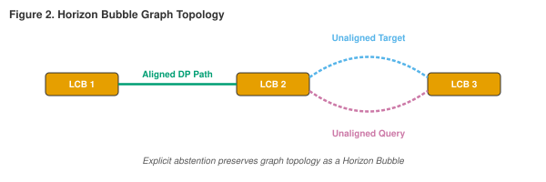
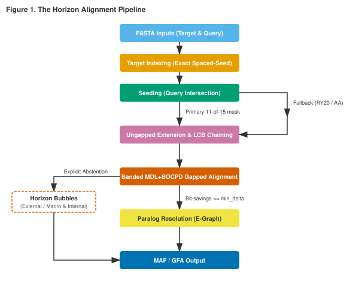

# Horizon Aligner: Complete Technical Manual

**Version:** 0.1.0  
**Author:** Richard Burhans  

---

## Table of Contents
1. [Introduction and Philosophy](#1-introduction-and-philosophy)
2. [Availability and Compilation](#2-availability-and-compilation)
3. [Overview of Processing Stages](#3-overview-of-processing-stages)
4. [Command Line Syntax](#4-command-line-syntax)
   - [horizon_wga (Pairwise Alignment)](#horizon_wga)
   - [horizon_merge (Multi-Species Merging)](#horizon_merge)
   - [horizon_guide (Progressive WGA)](#horizon_guide)
   - [horizon_tba (Reference-Free All-vs-All TBA)](#horizon_tba)
5. [Processing Stages in Detail](#5-processing-stages-in-detail)
   - [Sequence Input](#sequence-input)
   - [Indexing Target Seed Words](#indexing-target-seed-words)
   - [Seeding](#seeding)
   - [Gap-free Extension (HSP Gating)](#gap-free-extension-hsp-gating)
   - [HSP Chaining and LCB Generation](#hsp-chaining-and-lcb-generation)
   - [Gapped Extension (MDL+BOCPD)](#gapped-extension-mdlbocpd)
   - [Paralog Resolution via E-Graphs](#paralog-resolution-via-e-graphs)
6. [Output Formats](#6-output-formats)
7. [Advanced Topics](#7-advanced-topics)

---

## 1. Introduction and Philosophy

`horizon-aligner` is a fast, reference-free, whole-genome alignment tool in the lineage of BLASTZ and LASTZ. While traditional aligners rely on static, empirically derived substitution matrices (e.g., HOXD70) and affine gap penalties, these static parameters fundamentally miscalibrate when applied to compositionally extreme genomes (e.g., *Plasmodium falciparum* at ~19% GC) or across wide evolutionary spans where background AT/GC drift overwhelms homologous signal. Under Viterbi traceback, random AT-rich segments accumulate positive scores, leading to spurious alignments.

`horizon-aligner` solves this by replacing the static affine penalty model with a **Minimum Description Length (MDL)** framework, governed by **Bayesian Online Changepoint Detection (BOCPD)**. 

### Horizon Bubbles



*Figure 2. Explicit abstention produces unaligned Horizon Bubbles preserving graph topology.* Orange blocks represent chained locally colinear blocks (LCBs). The solid green path depicts an aligned region passing the minimum bit-savings threshold. Dashed paths (blue for target, pink for query) represent a "Horizon Bubble"—a region where the algorithm explicitly abstains from alignment, preserving the independent topologies of the divergent sequences without forcing spurious matches.

Instead of forcing low-confidence sequences to align or arbitrarily breaking the alignment, the aligner explicitly abstains. Regions lacking sufficient bit-savings are emitted as "Horizon Bubbles"—unaligned graphical paths preserving the structural topology.

---

## 2. Availability and Compilation

`horizon-aligner` is a pure Rust project. It requires `cargo` and `rustc` (Edition 2024).

```bash
cargo build --release
```

Binaries will be placed in `target/release/`:
* `horizon`: Unified subcommand dispatcher (`wga`, `merge`, `guide`, `tba`, `gfa`, `hal`, `lift`, `clean`, `resolve`, `filter`, `locus`, `eval`).
* `horizon_wga`: Pairwise WGA (`--maf`, `--gfa`, `--paf`, `--chain`, `--net`, `--tantan`, `--train-hmm`), DAG/POA (`--graph`), and HAL inspection (`--hal-info`).
* `horizon_merge`: Exact-coordinate multi-species MAF/rGFA merger.
* `horizon_guide`: Progressive guide-tree aligner with streaming HDF5 HAL export (`--hal`, `-q/--quiet`).
* `horizon_tba`: Reference-free Threaded Blockset Aligner (`--tree`, `--hinges`, `--auto-hinges`, `--extend-maf`, `--progressive-ancestors`, `--variation-gfa`, `--out-gz`, `--tantan`, `--pairwise-dir`, `--from-mafs`).
* `horizon_gfa`: Streaming GFA v1.0/v1.1 `stats`, `qc`, `list-walks`, `extract`, `from-maf`, and incremental `rgfa`.
* `horizon_hal`: Pure-Rust zero-`libhdf5` streaming multi-level HAL toolkit (`stats [--chroms]`, `liftover`, `to-maf`, `to-gfa`).
* `horizon_lift`: Graph-aware BED/GFF3 coordinate liftover.
* `horizon_clean`: BOCPD+MDL GFA junction scorer and Horizon Bubble cutter (`--min-haplotypes`, `--clip-bubbles-bp`).
* `horizon_resolve`: Standalone GFA `PackedGraph` snarl + e-graph walk resolver and phased VCFv4.2 exporter (`--vcf`, `--nested-snarls`).
* `horizon_filter`: Streaming SDUST+BOCPD+MDL PAF filter and `--net` interval netter (`--net-score mdl|log-length-ani`).
* `horizon_locus`: Regional `impg`-style multi-FASTA locus aligner (`--hnex`, `--consistency`, `--repair-frameshifts`) and similarity matrix emitter.
* `horizon_eval`: Pairwise MAF recall/precision evaluator.

---

## 3. Overview of Processing Stages



*Figure 1. Flowchart of the Horizon Aligner processing stages.* The algorithm proceeds through target indexing, spaced-seed querying, ungapped extension, banded gapped alignment, and e-graph paralog resolution. Arrows indicate the flow of sequence data, highlighting the explicit abstention pathway that bypasses forced alignment in low-confidence regions. Colors denote distinct algorithmic phases.

The general flow of `horizon-aligner` mimics the traditional BLASTZ/LASTZ pipeline but introduces novel theoretical frameworks at key bottlenecks:

1. **Target Indexing:** The target sequence is mapped using exact spaced-seed hashing.
2. **Seeding:** The query sequence is hashed and intersected with the target to find seed hits.
3. **Ungapped Extension:** Seeds are extended without gaps into High-Scoring Segment Pairs (HSPs).
4. **Chaining:** HSPs are chained into Locally Colinear Blocks (LCBs).
5. **Gapped Extension:** The gaps between LCBs are evaluated using banded DP guided by MDL bit-savings.
6. **Resolution:** Overlapping structures are saturated in a congruence-closed e-graph.

---

## 4. Command Line Syntax

### `horizon_wga`
Performs pairwise whole-genome alignment.

```bash
horizon_wga <target.fa> <query.fa> [max_contigs] [OPTIONS]
```
**Options:**
* `--maf <path>`: Write the resulting colinear alignment blocks to a MAF v1 file.
* `--gfa <path>`: Write the resulting alignment graph, including Horizon Bubbles, to a GFA v1.1 file.
* `--paf <path>`: Write standard 12-column PAF v1 records with extended `cg:Z:` CIGAR (`=`/`X`/`I`/`D`) and `tp:A:P` tags (supports `.paf`, `.paf.gz`, `.paf.zst`).
* `--chain <path>`: Write UCSC `.chain` pairwise chains (score-ranked descending with 1-based IDs and UCSC reverse-strand query coordinates; supports `.chain.gz` and `-`).
* `--net <path>`: Write hierarchical UCSC `.net` trees (`fill`/`gap` with `top`, `syn`, `inv`, `dup`, `nonSyn`, `id`, `score`, `ali`, `qOver`, `qFar`, `qDup`, and forward `+` query coordinates; supports `.net.gz` and `-`).
* `-t, --threads <N>`: Limit Rayon worker threads (default: all host cores; supported uniformly across `horizon_wga`, `horizon_guide`, `horizon_tba`, `horizon_merge`, `horizon_locus`, `horizon_filter`, `horizon_eval`, `horizon_clean`, and `horizon_resolve`).
* `--one-to-one`: Net overlapping colinear run-groups across all contig pairs to strict species-wide 1-to-1 orthology in $O(R \log R)$ time using canonical ACGT identity scoring (`2 * matches - mismatches`, `src/netting.rs`).
* `--hal-info <path>`: Decode an HDF5-encoded HAL file directly via fail-closed `Read + Seek` traversal.
* `--graph <target.gfa[.gz]>`: Align `query.fa` against a GFA pangenome graph using seeded topological DAG/POA MDL dynamic programming (`src/mdl/dag.rs`, capped at `MAX_DAG_DP_CELLS = 32_000_000`).
* `--top-k <K>`: Retain only the highest scoring $K$ alignments per query contig.
* `--rbest`: Syntactic sugar for `--top-k 1` (Reciprocal Best Hit).
* `--resolve-dups`: Enable overlap-clustered empirical MDL `k`-copy e-graph paralog resolution and pruning (`src/formats/dup_resolve.rs`).
* `--respect-softmask`: Treat lowercase nucleotides as masked.
* `--ry-seeds` / `--no-ry-seeds`: Toggle the 1-bit `MASK_RY18` (purine/pyrimidine) fallback seeding for deep divergence.
* `--min-shared-seeds <N>`: Set the minimum number of shared seeds (default: 8).
* `--min-top-lcb <N>`: Set the minimum length of the top LCB block.
* `--min-fallback-cov <F>`: Trigger fallback seeding when primary coverage falls below `F`.
* `--hsp-threshold <N>`: Override the Karlin–Altschul HSP ungapped extension score threshold.

### `horizon_merge`
Executes an $O(N \log N)$ sweep-line exact-coordinate algorithm to merge multiple pairwise MAFs against a common reference, streaming multi-species MAF and rGFA directly to disk via `merge_pairwise_maf_paths_to_writers`.

```bash
horizon_merge <ref_species> <bin_bp> <maf_out> <gfa_out> <sp1=path1.maf> [<sp2=path2.maf> ...]
```
* `bin_bp`: Window size for the exact-coordinate projection (e.g. 1000).

### `horizon_guide`
Orchestrates star or progressive multi-species alignment using `auN`-contiguity-weighted MinHash central-hinge selection (`--hinge` override), Rayon-parallel pairwise alignment, BFS dependency-wave UPGMA sister-clade transitive rescue (`rescue.rs`), single-pass MAF-bucketed `16 Mb` two-pass ancestral consensus bridging (`consensus.rs`), and `4 MiB`-windowed streaming Fitch HDF5 HAL export (`--hal`, `hal_export.rs`).

```bash
horizon_guide [--progressive] [--hinge <species>] [--respect-softmask] [--hal] [-t N] [-q] [--rbest | --top-k K | --all-pairs] <out_prefix> <max_contigs> <sp1=fa1> <sp2=fa2>...
```

### `horizon_tba`
Reference-free Threaded Blockset Aligner supporting all-vs-all alignment, two-tier clade-hinge projection (`--hinges`, `--auto-hinges` via streaming Eisenstein sketching, `--tip-map`, `--extend-maf`), bottom-up Progressive Cactus-style ancestral alignment (`--progressive-ancestors`, `--ancestral-model fitch|ml`, `--max-outgroups`, `--emit-ancestors`, `--hal`), Rayon POA block refinement, atomic `--pairwise-dir` / `--pairwise-gz` lazy-gzip checkpointing, and `--from-mafs` merge-only mode, emitting MAF v1 and walk-consistent GFA v1.1 (`S`, `L`, and `W` walks).

```bash
horizon_tba [OPTIONS] <out_prefix> <max_contigs> <sp1=fa1> <sp2=fa2>...
horizon_tba --from-mafs <maf_dir> [--tree <newick|file>] [-t N] [-q] <out_prefix> <sp1> <sp2>...
horizon_tba --extend-maf <backbone.maf> [--tip-map <tsv>] [-t N] [-q] <out_prefix> <max_contigs> <hinge=fa>... <tip=fa>...
```
Key options: `--tree <newick|file>`, `--hinges <sp1,sp2,...>`, `--auto-hinges <H>`, `--tip-map <tsv>`, `--progressive-ancestors`, `--ancestral-model <fitch|ml>`, `--max-outgroups <K>` (default `3`), `--emit-ancestors <dir>`, `--hal`, `--pairwise-dir <dir>`, `--pairwise-gz`, `--respect-softmask`, `--rbest | --top-k K | --all-pairs`, `-t/--threads <N>`, `-q/--quiet`.

### `horizon_gfa`
Streams plain, BGZF/gzipped (`.gfa.gz`), `.zst`, or `stdin` (`-`) GFA v1.0/v1.1 graphs for `O(1)`-memory structural `stats`, `list-walks`, streaming two-pass chromosome FASTA `extract`, or Minigraph-style incremental `rgfa` construction (`src/rgfa.rs`).

```bash
horizon_gfa stats <in.gfa[.gz]|->
horizon_gfa list-walks <in.gfa[.gz]> [filter] [limit]
horizon_gfa extract <in.gfa[.gz]> [--max-bp N] <sample_prefix:seq_id:out.fa>...
horizon_gfa rgfa --ref <ref.fa> --query <q.fa> [--query <q2.fa>...] [--min-sv-bp 50] [--out <out.rgfa>]
```

### `horizon_lift`
Lifts BED or GFF3 coordinates between haplotypes in a GFA pangenome graph using two-pass `P`/`W` streaming, `--bridge-bp` micro-bubble coalescing (default `0`), `--min-frac` filtering (default `0.0`), `--to-chrom` target chromosome filtering, and UCSC reverse-strand arithmetic.

```bash
horizon_lift --gfa <in.gfa[.gz|.zst]|-> --from <src_prefix> --to <tgt_prefix> (--bed <in.bed> | --gff <in.gff3>) [--out <out.bed>] [--unmapped <unmapped.bed>] [--bridge-bp 0] [--min-frac 0.0] [--to-chrom C1,C2]
```

### `horizon_clean`
Scores candidate GFA `L`-line junctions with `bocpd_gc_profile` and MDL two-regime changepoint bit gain (`--min-cp-bits`), preserving `S`-line optional tags while severing low-support (`walk_support <= 1` by default, or `0` with `--prune-unsupported`) discordant edges into `HB:i:1` Horizon Bubbles, and optionally pruning low-haplotype-support segments (`--min-haplotypes`) or large bubbles (`--clip-bubbles-bp`).

```bash
horizon_clean --gfa <in.gfa[.gz|.zst]|-> [--out <clean.gfa>] [--flank 128] [--min-cp-bits 12.0] [--prune-unsupported] [--min-haplotypes <K>] [--clip-bubbles-bp <N>]
```

### `horizon_resolve`
Runs standalone MDL-calibrated `k`-copy e-graph resolution (`MdlCostModel`) over a `u32`-interned `PackedGraph` (`src/bin/horizon_resolve/{main,snarl,resolve,vcf}.rs`) with $O(V + E)$ Tarjan biedged snarl decomposition and topological window-divergence estimation (`[0.02, 0.15]` heuristic unless `--divergence` is passed), canceling double inversions, collapsing tandem repeat arrays, streaming `S`-line sequences intact, updating `W`-line `end` bounds, pruning/synthesizing `L` links (assuming `0M` overlaps), and optionally projecting Tarjan snarls to phased VCFv4.2 (`--vcf`, `--vcf-ref`).

```bash
horizon_resolve <in.gfa[.gz|.zst]|-> [--out <resolved.gfa>] [--vcf <out.vcf[.gz]>] [--vcf-ref <sample>] [--max-bubble-steps 16] [--min-anchor-bp 200] [--divergence 0.02] [--collapse-dups] [--tag-walks]
```

### `horizon_filter`
Streams `.paf[.gz|.zst]` or `stdin`, evaluates `FastGA`/`wfmash` PAF alignments with SDUST repeat masking, Pair-HMM MDL bit-savings, and operator-matched biological decoy CRC (`--crc-alpha`, `--crc-n-cal`, emitting `md:f:` and `hb:i:` tags), and optionally nets overlapping alignments (`--net` / `--max-occ`, `--keep-all`).

```bash
horizon_filter --paf <in.paf[.gz|.zst]|-> [--query <q.fa>] [--target <t.fa>] [--seqs <all.fa>] [--out <out.paf[.gz|.zst]>] [-t N] [--min-bits <F>] [--crc-alpha <F>] [--crc-n-cal <N>] [--min-nonrepeat-bp <N>] [--min-len <N>] [--net | --max-occ <K>] [--keep-all]
```

### `horizon_locus`
Aligns all sequence pairs in a regional `impg`-style multi-FASTA (`.fa[.gz|.zst]`) using `SDUST + BOCPD/MDL + Aa5Index`, emitting `<prefix>.similarity.tsv` (`jaccard_cov`, `p_dist`, `jc69_dist`, Horizon Bubbles), `<prefix>.bionj.nwk` (BioNJ guide tree), `<prefix>.maf`, `<prefix>.gfa`, optional lossless `<prefix>.hnex` (`--hnex`), and optional ProbCons probabilistic consistency MSA (`--consistency`).

```bash
horizon_locus --fasta <locus.fa[.gz|.zst]> --out-prefix <prefix> [--ref <seq_name>] [--threads <N>] [--respect-softmask] [--hnex] [--consistency]
```

### `horizon_eval`
Evaluates pairwise alignment recall and precision against a reference MAF file in $O(R \log R)$ time and $O(R)$ memory via sorted merged `DiagRun` interval intersection.

```bash
horizon_eval <ref_name> <tgt_name> <ref.fa> <tgt.fa> <truth.maf> [-t N | --threads N] [--min-fallback-cov F] [--hsp-threshold N]
```

---

## 5. Processing Stages in Detail

### Sequence Input
Sequences are read from plain, `.gz`/`.bgz`, or `.zst`/`.zstd` FASTA files via `src/io_util.rs`. If `--respect-softmask` is supplied, lowercase bases (e.g. `a`, `c`, `g`, `t`) are ignored during indexing, dramatically reducing seed collision depth in repetitive regions.

### Indexing Target Seed Words
`horizon-aligner` stores each contig's sequence once inside an owned `ContigIndex` (`prepare_contig_index_owned` in `src/seeding/sketch.rs`), combining an $O(N)$ SDUST triplet repeat mask (`sdust_mask`), bottom-$k$ MinHash sketch, and a compact `FlatSeedIndex` (`12 B/entry` + 16-bit prefix buckets).

### Seeding
Instead of contiguous k-mers, `horizon-aligner` leverages **spaced seeds**:
* **Primary Seeding:** Uses `MASK_PRIMARY_11_15` (`111011011011011`) and `MASK_PH11_18` (`111010010100110111`). Matches strictly require 11 bases to match across the spaced span using strand-symmetric `fwd.min(rc)` packing.
* **Fallback Seeding (Distant Divergence):** If primary seed coverage drops below the configured coverage threshold, `horizon-aligner` engages progressive fallback tiers:
  * **Transition-Tolerant Seeds (`MASK_LASTZ12`, `MASK_LASTZ11`):** Captures 1- and 2-transition mutations via single-cycle XOR bit flips (`x ^ 2`).
  * **R/Y Seeds (`MASK_RY18`):** Translates the genome into a 1-bit purine (R) / pyrimidine (Y) alphabet (18-of-25) before seeding. Highly effective for deep evolutionary splits.
  * **Amino Acid Translated Seeds (`AA5`):** Executes 6-frame translation into 9 biochemical groups and matches on a 5-of-6 amino acid shape.

### Gap-free Extension (HSP Gating)
Candidate seeds are extended in both directions without gaps to form High-Scoring Segment Pairs (HSPs). Thresholds follow constant-$E$ Karlin–Altschul search-space scaling (`HSP_SCALE = 7.25` in `src/seeding/hsp.rs`, scaling smoothly with $\log_2(N \cdot M)$).

### HSP Chaining and LCB Generation
Valid HSPs are chained using $O(M \log M)$ patience-sorting **Longest Increasing Subsequence (LIS)** and `BTreeSet`-indexed LCB clustering (`src/seeding/chain.rs`). For uncovered gaps $\le 2.4$ kb, the aligner sweeps with dense `w=9` (`MASK_W9`) or `w=10` (`MASK_W10`) masks.

### Gapped Extension (MDL+BOCPD) & HOXD70 Micro-Gap Realignment
The core DP algorithm runs on inter-LCB gaps up to `max_gap_bp` (`2400 bp`):
1. **X-Drop (`src/mdl/xdrop.rs`):** Flanks of LCBs extend into gaps up to `1500 bp`, gated by the calibrated CRC floor (`min_peak_bits`).
2. **BOCPD (`src/bocpd.rs`):** Exact Adams & MacKay `(1.0, 1.0)` Beta-Bernoulli BOCPD estimates local GC $\hat{g}(t)$ online while leaving ambiguous `N` bases neutral.
3. **MDL Forward-Backward MEA & Composition-Aware Fast Paths (`src/mdl/dp.rs`, `src/mdl/dp_fast.rs`):** Computes exact row-scaled Forward-Backward bit-savings $\Delta\mathrm{MDL}$ and MEA decoding (`P(M_ij) - 0.25`), accelerated on balanced conserved gaps by composition-aware diagonal and narrow-Viterbi fast paths (enforcing `im_bits` and per-block `min_block_bits` across indels) and local-BOCPD-scored exact flank trimming.
4. **Horizon Bubbles & CRC (`src/mdl/crc.rs`):** Calibrates $\hat{\lambda}$ against `n_cal = 49` reversed biological + GC-matched decoys ($\alpha = 0.07$), floored by $\max(10.0, 0.55\log_2(N \cdot M))$ bits. Intervals below $\hat{\lambda}$ or $P(M_{i,j}) < 0.15$ abstain explicitly as micro or macro Horizon Bubbles.
5. **Micro-Gap Realignment (`src/formats/realign.rs`):** Short inter-run gaps (`<= MAX_COLINEAR_GAP_BP = 40 bp`) inside colinear MAF blocks are realigned on the stack using the evolutionary HOXD70 matrix (with neutral `0` scoring on `N` bases), preventing balanced `X-/-Y` skip artifacts while preserving coding reading frames.

### Paralog Resolution via E-Graphs
To handle nested inversions and tandem duplications, overlapping blocks are modeled as an `Expr` inside a deterministic `BTreeMap`-backed congruence-closed `EGraph` (`src/egraph.rs`). `MdlCostModel` extracts the minimum-description-length structural path without losing evolutionary topology.

---

## 6. Output Formats

### Multiple Alignment Format (MAF)
A standard, text-based format for colinear alignments.
* Coordinates are strictly **0-based, half-open** (managed by `coord::Interval`).
* For alignments on the reverse strand (`-`), the start coordinate is `src_size - end_pos`.
```text
##maf version=1 scoring=horizon_mdl
a score=50.0
s hg38.chr22 100 50 + 50000000 ACTGACTG...
s mm10.chr11 200 50 - 120000000 ACTGACTG...
```

### Graphical Fragment Assembly (GFA v1.1)
Outputs the alignment as a sequence graph. Homologous blocks are `S` (Sequence) lines. Unaligned Horizon Bubbles are represented as parallel, disjoint sequences connecting the same bounding LCBs.
```text
H VN:Z:1.1
S hg38__mm10__blk_0 * LN:i:50 XS:i:100 YS:i:200 ST:Z:-
# E-graph paralog metadata is appended to S lines when `--resolve-dups` is used.
```

---

## 7. Advanced Topics

### Coordinate Arithmetic (`coord.rs`)
Coordinate boundaries can easily drift by off-by-one errors during strand inversion. `horizon-aligner` handles all UCSC-style coordinate translation explicitly inside the `coord::Interval` struct, ensuring that span sizes and endpoints remain invariant when mapped to the complementary sequence.

### HDF5 HAL Parsing & Writing (`hal/`)
`horizon` natively decodes and writes Hierarchical Alignment (HAL) graphs stored in HDF5 with zero `libhdf5` dependency:
* **Fail-closed `Read + Seek` reader (`src/hal/hdf5_read.rs`, `src/hal/hdf5_dataset.rs`):** Extracts superblocks, `v1` object headers + `0x0010` continuations, group/chunk B-trees, and `zlib`-deflated 1D chunked datasets under strict metadata and cumulative `256 MiB` decompression budgets, failing closed (`Ok(None)`) on any structural violation or truncation.
* **Streaming progressive writer (`src/hal/hdf5_write.rs`, `src/hal/hdf5_progressive.rs`, `src/hal/fitch.rs`):** Emits `libhdf5`-compatible HDF5 `v0` archives with multi-level B-trees (`>256` entries), internal ancestral `bottom_parse`/`top_parse` edges, and `4 MiB`-windowed streaming two-pass Fitch parsimony (`N`-scaffold preserving, ~240 MiB RAM even on 100-way 3 Gbp mammalian alignments).
