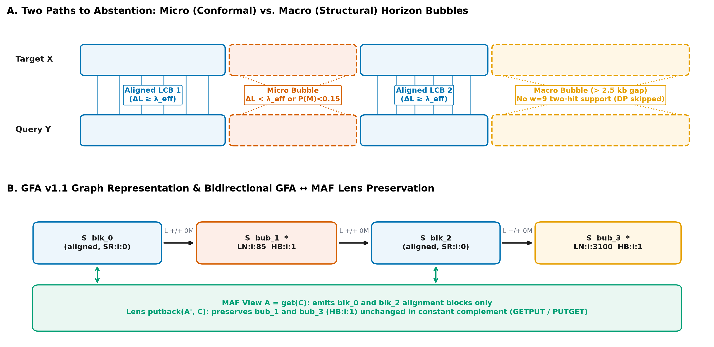

# 1. The Problem With Forced Base-by-Base Alignment

Classical whole-genome aligners face an unspoken binary choice between two anchors:

1. **Force an alignment through the gap:** Standard affine-gap Viterbi dynamic programming (e.g., `LASTZ`, `Cactus` pairwise steps) emits base-by-base pairs across hypervariable loops, lineage-specific transposon insertions, or AT-rich subtelomeric repeats. Downstream phylogenetic and selection (`dN/dS`) pipelines then mistake non-homologous noise for rapid evolution.
2. **Drop the interval silently:** Reference-only `MAF` blocks omit unaligned spans altogether, leaving downstream tools unable to tell whether a missing region was unsequenced, structurally rearranged, or genuinely unalignable between two flanking orthologs.

A **Horizon Bubble** is Horizon's third option: an explicit, syntenically anchored graph node (`HB:i:1`) that says *"the flanking blocks are homologous, but the intervening span cannot be aligned above calibrated noise."*

---

# 2. Two Paths That Create a Horizon Bubble

Horizon emits bubbles at two distinct stages of the alignment pipeline (`src/mdl.rs`, Figure 1A):



**Figure 1. Anatomy of a Horizon Bubble and its lossless `GFA v1.1` / `MAF` representation.** **A.** Flanking locally collinear blocks (`LCB 1`, `LCB 2`) pass both MDL bit-savings (`ΔL ≥ λ_eff`) and column posterior (`P(M_ij) ≥ 0.15`) gates, whereas low-signal DP gaps become **Micro Bubbles** (`bub_1`) and unanchored spans exceeding `2.5 kb` become **Macro Bubbles** (`bub_3`). **B.** `GFA v1.1` preserves every bubble as an explicit `S ... * LN:i:<len> HB:i:1` node linked by `0M` edges (`L`), while the bidirectional `GFA ↔ MAF` lens (`src/formats.rs`) projects aligned blocks into `MAF` and keeps bubbles untouched in the constant complement. Visual dictionary: blue marks aligned blocks, vermilion marks conformal micro bubbles, orange marks structural macro bubbles, and green marks the bidirectional `MAF` lens view.

## 2.1 Micro (Conformal) Bubbles (`internal_bubbles`)

Inside `banded_mdl_gap`, Horizon scores each inter-anchor gap (`X`, `Y`) using its BOCPD-parameterized three-state MDL pair-HMM and checks two calibrated gates (Angelopoulos et al. 2024):

1. **Bit-savings gate:** `ΔL < λ_eff`, where `λ_eff = max(10.0, 0.55 · log₂(N · M))` bits. If compressing `X` and `Y` jointly does not beat independent BOCPD null encoding by at least `λ_eff` bits, the entire gap is quarantined as a micro bubble.
2. **Per-column posterior gate:** Even when a gap passes `λ_eff` overall, any internal run of columns whose forward-backward match posterior drops below `P(M_ij | X, Y) < 0.15` is split into flanking aligned segments separated by a micro bubble (`bub_k`).

## 2.2 Macro (Structural) Bubbles (`macro_bubbles`)

Between distant locally collinear blocks (LCBs), Horizon first runs a fast local `w = 9` two-hit sub-chaining pass. Any inter-LCB span exceeding the `2.5 kb` gap ceiling without two-hit diagonal support is emitted immediately as a **macro bubble** without running quadratic dynamic programming. On *Plasmodium malariae* × *P. brasilianum*, this quarantined `536,041` repetitive and subtelomeric intervals in `17.12 min` rather than burning hours inside `14.3 h` of futile DP.

---

# 3. Exact Wire Representation in `GFA v1.1` and `MAF`

In `format_gfa_blocks` (`src/formats.rs`), Horizon emits aligned segments and bubbles as first-class `GFA v1.1` records:

```text
H	VN:Z:1.1	# HB:Z:macro=0,internal=1
S	c1__c2__blk_0	ACGTACGTACGTACG	SR:i:0
S	c1__c2__bub_1	*	LN:i:85	HB:i:1
S	c1__c2__blk_2	TTGGCCAATTGGCCA	SR:i:0
L	c1__c2__blk_0	+	c1__c2__bub_1	+	0M
L	c1__c2__bub_1	+	c1__c2__blk_2	+	0M
```

- **`S ... * LN:i:85 HB:i:1`:** Marks an unaligned `85 bp` Horizon Bubble spanning the coordinate gap between `blk_0` and `blk_2`.
- **`L ... 0M`:** Preserves topological adjacency across the bubble so pangenome and synteny viewers see an unbroken chromosome path.
- **Bidirectional `GFA ↔ MAF` Lens (Foster et al. 2007):** Because standard `MAF` only represents aligned base columns, `get(C)` projects `blk_0` and `blk_2` into `MAF`. When an external tool edits the `MAF` and maps back via `putback(A', C)`, Horizon preserves every `HB:i:1` bubble node in the constant complement (`GETPUT` and `PUTGET` hold identically).

---

# 4. What Horizon Bubbles Do in Practice

- **Zero false alignment on random AT-rich DNA:** On an unalignable `18%`-GC synthetic pair where `HOXD70` aligns `87.2%` of bases, Horizon abstains on `100%` of columns (`0.000` false alignment).
- **Selective pruning of real `LASTZ` noise:** On *P. falciparum* × *P. vivax* Chromosome 1 (`21.3` percentage-point GC gap), Horizon abstains on `87.7%` of `LASTZ` `HoxD55` columns that fail the `10`-bit MDL test.
- **Zero collateral loss on clean homology:** With the exact same parameters, Horizon retains `99.95%` (`418,465 / 418,663`) of intraspecific *Cannabis sativa* columns.

---

# 5. References {.unnumbered}

- **Angelopoulos AN, Bates S, Fisch A, Lei L, Schuster T** (2024). Conformal risk control. *ICLR 2024* (`arXiv:2208.02814`).
- **Foster JN, Greenwald MB, Moore JT, Pierce BC, Schmitt A** (2007). Combinators for bidirectional tree transformations: A linguistic approach to the view-update problem. *ACM TOPLAS*, 29(3):17.
