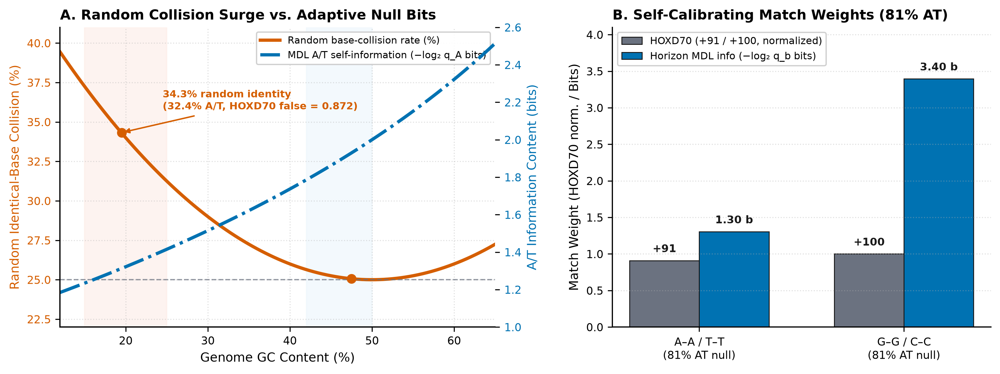
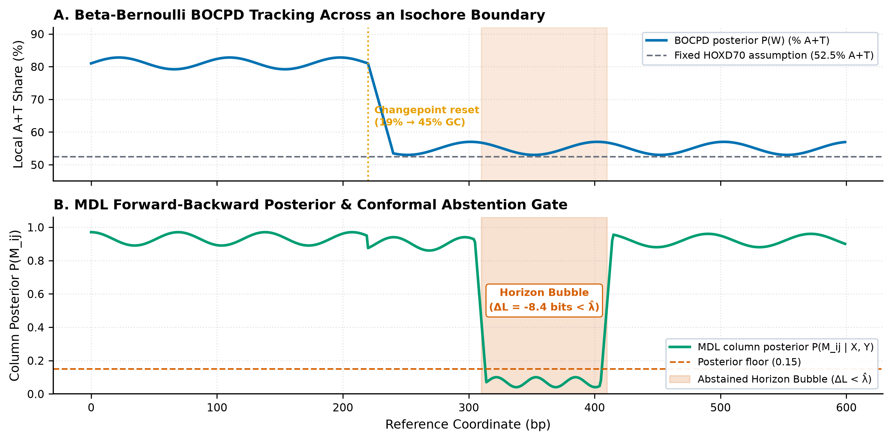
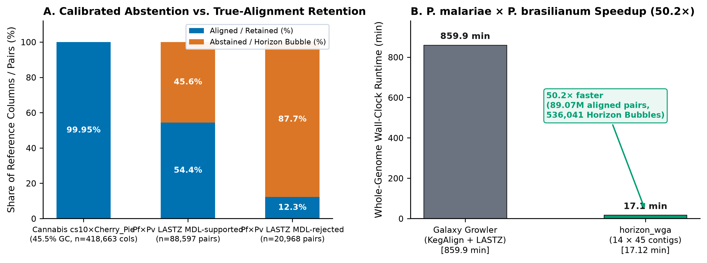

# 1. The Hidden Assumption Inside `HOXD70`

Every classical pairwise substitution matrix—including `HOXD70` (Chiaromonte et al. 2002), `BLOSUM`, and `LASTZ`'s default `HoxD55`—is a matrix of log-odds ratios:

```text
S(a, b) = log₂( P(a, b | homologous) / (q_a · q_b) )
```

The denominator `q_a · q_b` encodes the **background base frequencies** of the genomes used to calibrate the matrix. For `HOXD70`, those frequencies were estimated from human–mouse alignments near `47.5%` GC (`q_A = q_T ≈ 0.2625`, `q_C = q_G ≈ 0.2375`). Under that assumption:

- Two unrelated nucleotides match as `A–A` or `T–T` with probability `2 · 0.2625² ≈ 0.138` (`13.8%`).
- Because an `A–A` match is relatively rare under a balanced null, `HOXD70` awards it `+91` points while penalizing transitions (`−114`) and transversions (`−123`).

Now apply that same matrix without recalibration to *Plasmodium falciparum*, whose genome averages `19.5%` GC (`80.5%` AT, `q_A = q_T ≈ 0.4025`). Two completely unrelated random sequences drawn from `80.5%` AT collide as `A–A` or `T–T` with probability:

```text
2 · 0.4025² ≈ 0.324   (32.4% random identity)
```

More than **one in three** columns matches by pure chance (`32.4%` A/T collisions plus `1.9%` G/C collisions = `34.3%` total random identity). Under `HOXD70`'s `+91` match reward, random `80%`-AT DNA accumulates local positive excursions that outrun affine gap penalties, causing Viterbi dynamic programming to string together random AT-rich intervals into long, confident-looking alignments (`0.872` false-positive rate on unalignable `18%`-GC synthetic pairs).



**Figure 1. Fixed log-odds matrices fail as random AT collisions surge, whereas MDL scales match weights automatically.** **A.** Total random identical-base collision probability (vermilion) rises from `25.1%` at `47.5%` GC to `34.3%` at `19.5%` GC, while Horizon's adaptive A/T self-information `−log₂(q_A)` (blue dashed-dotted) decreases smoothly from `1.93` to `1.30` bits. **B.** In an `81%`-AT isochore (`q_A = q_T = 0.405`, `q_G = q_C = 0.095`), `HOXD70` keeps `A–A` (`+91`) and `G–G` (`+100`) nearly equal, whereas MDL weights rare `G–G` matches (`3.40` bits) nearly three times higher than common `A–A` matches (`1.30` bits). Visual dictionary: vermilion shows random collision rate, blue shows MDL information content in bits, and gray shows normalized `HOXD70` match scores.

---

# 2. Why Fixed Sliding Windows and Single-Genome Matrices Still Fail

A common workaround is to recompute a single organism-specific matrix (such as `HoxD55` or an AT-adjusted matrix) for the whole genome. That breaks down in two real biological regimes:

1. **Intragenomic Isochores:** Even within a single chromosome, *P. falciparum* coding exons can sit near `25–30%` GC while intergenic introns drop below `13%` GC. In cross-clade comparisons such as *P. falciparum* (`20.5%` GC) × *P. vivax* (`37.5%` GC), GC content jumps by `17–25` percentage points across adjacent windows.
2. **Sharp Boundaries:** A fixed-width sliding window (e.g., `500 bp`) smears composition across `18%` ↔ `45%` GC transitions, under-penalizing AT-rich flanks adjacent to GC-rich exons.

---

# 3. Horizon's Solution: BOCPD + Two-Part MDL (`ΔL`)

Instead of hardcoding `q_a`, Horizon treats alignment as a **two-part Minimum Description Length (MDL) compression race** driven by local online composition tracking (`src/bocpd.rs`, `src/mdl.rs`).

## 3.1 Step 1: Online Weak/Strong Tracking (`bocpd_gc_profile`)

Before aligning any pair, `bocpd_gc_profile` scans the binary weak/strong hydrogen-bond stream `x_t ∈ {0, 1}` (`1` for `A/T`, `0` for `G/C`) using Beta-Bernoulli Bayesian Online Changepoint Detection (Adams & MacKay 2007). At every base `t`:

- Inside a homogeneous isochore, the run-length posterior concentrates on long runs `r_t`, smoothly refining `P(W_t) = (α_0 + s_r) / (α_0 + β_0 + r)`.
- At an abrupt `19%` → `45%` GC boundary, the constant hazard `h` immediately shifts posterior mass back to `r_t = 0`, resetting `P(W_t)` within a handful of bases (Figure 1A).



**Figure 2. Online BOCPD tracking across an isochore boundary drives calibrated MDL abstention.** **A.** Local A+T share (`P(W)`) estimated by `bocpd_gc_profile` resets cleanly at an abrupt `19%` → `45%` GC boundary (`t ≈ 220 bp`), whereas `HOXD70`'s fixed `52.5%` A+T prior miscalibrates the `~81%`-AT left isochore. **B.** Three-state MDL column posteriors `P(M_ij | X, Y)` stay near `0.90–0.97` across conserved flanks and collapse below the `0.15` floor inside an unalignable loop (`310–410 bp`), triggering an explicit Horizon Bubble (`ΔL = −8.4 bits < λ̂`). Visual dictionary: blue shows BOCPD `P(W)`, orange marks the changepoint reset, green shows MDL column posteriors, and shaded vermilion marks the abstained Horizon Bubble.

## 3.2 Step 2: Compression Race in Bits (`banded_mdl_gap`)

Given local base frequencies `q_X(t)` and `q_Y(t)` from BOCPD, Horizon computes two exact codelengths in bits using a three-state pair-HMM (`M`, `I`, `D`) adapted from Allison, Wallace, and Yee (1992).

1. **Null codelength `L_null`:** The bits required to transmit `X` and `Y` independently under their local BOCPD compositions:
   ```text
   L_null = −log₂ P_BOCPD(X) − log₂ P_BOCPD(Y)
   ```
2. **Joint codelength `L_joint`:** The bits required to transmit `X` and `Y` together via the forward sum over all alignable paths:
   ```text
   L_joint = −log₂ P(X, Y | aligned)
   ```
3. **Net bit savings `ΔL`:**
   ```text
   ΔL = L_null − L_joint
   ```

Why does `ΔL` neutralize AT-rich false positives automatically? Look at the per-base information content:

- In an `81%`-AT region (`q_A = 0.405`), transmitting an `A` independently costs `−log₂(0.405) = 1.30` bits. An `A–A` match only saves at most `1.30` bits minus the pair-HMM conservation overhead (`~0.15` bits) and state-transition cost. Random `32%` AT collisions cannot outrun mismatch and gap penalties, so `ΔL` stays **negative** on unrelated AT-rich DNA.
- In the exact same region, a conserved `G–G` match (`q_G = 0.095`) saves `−log₂(0.095) = 3.39` bits—nearly three times as much information—automatically weighting rare GC matches higher without any hand-tuned matrix!

## 3.3 Step 3: Search-Space Scaling and Conformal Abstention

To prevent overfitting to short test blocks, Horizon never uses magic per-species thresholds. Instead, `src/mdl.rs` scales the minimum bit-savings floor continuously with the Karlin–Altschul search space of the two sequences (`N = len(X)`, `M = len(Y)`):

```text
search_space_bits = 0.55 · log₂(max(N, 1) · max(M, 1))
λ_eff             = max(λ̂, search_space_bits)
```

where `λ̂ = 10.0` bits is calibrated once via Conformal Risk Control (Angelopoulos et al. 2024) at risk level `α = 0.07`. Any interval with `ΔL < λ_eff`—or any internal column whose forward-backward posterior `P(M_ij | X, Y) < 0.15`—is withheld from base-level alignment and emitted explicitly as a **Horizon Bubble** (`# HB:Z:`).

---

# 4. Empirical Proof: Zero Retuning Across Kingdoms

The strongest test against overfitting is running the **exact same binary and parameters** on opposite compositional extremes:



**Figure 3. Conformal abstention separates true intraspecific homology from low-signal cross-clade noise without retuning.** **A.** Share of columns retained (blue) versus abstained as Horizon Bubbles (vermilion) across intraspecific *Cannabis sativa* (`99.95%` retained), *P. falciparum* × *P. vivax* MDL-supported `LASTZ` pairs (`54.4%` retained), and MDL-rejected `LASTZ` pairs (`87.7%` abstained). **B.** Whole-genome wall-clock runtime on *P. malariae* × *P. brasilianum* (`14 × 45` contigs): Galaxy `Growler UCSC pair` (`859.9 min`) versus `horizon_wga` (`17.12 min`, `50.2×` speedup).

- **Synthetic `18%`-GC random pair:** `HOXD70` aligns `87.2%` of bases falsely. Horizon aligns `0.000`.
- **Real *P. falciparum* × *P. vivax* Chromosome 1 (`21.3` percentage-point GC gap):** `20.7%` (`24,748 / 119,582`) of `LASTZ` `HoxD55` columns fail the `10`-bit MDL test. End-to-end `horizon_wga` abstains on `87.7%` of those low-signal columns.
- **Real intraspecific *Cannabis sativa* (`45.5%` GC, `418,663` columns):** With zero parameter changes, Horizon retains `99.95%` (`418,465`) of true reference `MAF` columns.

---

# 5. References {.unnumbered}

- **Adams RP & MacKay DJC** (2007). Bayesian online changepoint detection. *arXiv:0710.3742*.
- **Allison L, Wallace CS, Yee CN** (1992). Finite-state models in the alignment of macromolecules. *Journal of Molecular Evolution*, 35(1):77–89.
- **Angelopoulos AN, Bates S, Fisch A, Lei L, Schuster T** (2024). Conformal risk control. *ICLR 2024* (`arXiv:2208.02814`).
- **Chiaromonte F, Yap VB, Miller W** (2002). Scoring pairwise genomic sequence alignments. *Pacific Symposium on Biocomputing*, 115–126.
