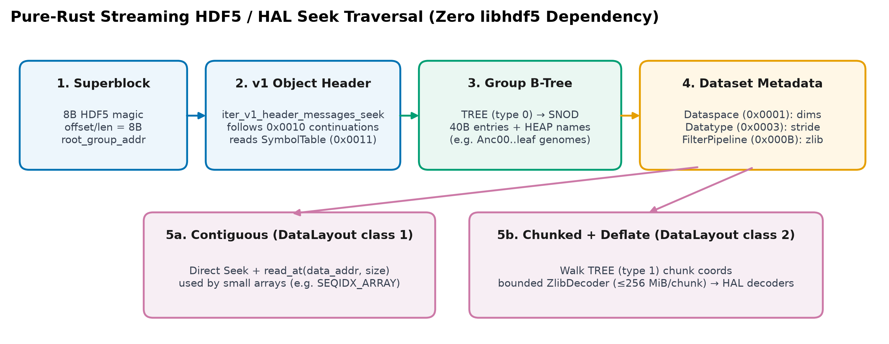

# 1. Why Build a Pure-Rust HDF5 / `HAL` Reader?

The Hierarchical Alignment (`HAL`) format (Hickey et al. 2013) is the standard interchange format for Progressive Cactus multi-hundred-genome alignments (`363-avian-2020.hal`, `241-mammalian-2020v2.hal`, Ensembl `sars-cov-2.hal`). Every `.hal` file is an **HDF5** container storing a Newick phylogeny and five binary datasets per genome.

Normally, reading `.hal` requires linking the C `libhdf5` shared library and the C++ `hal` API, which complicates static Rust builds, cross-compilation, and Galaxy/Bioconda packaging. Horizon's `src/hal.rs` eliminates `libhdf5` entirely by implementing:

1. An in-memory hierarchical alignment model (`HalAlignment`, `HalGenome`, `HalTopSegment`, `HalBottomSegment`).
2. A zero-dependency, streaming `Read + Seek` HDF5 `v0`/`v1` container reader (`BufReader<File>`) that never loads whole multi-gigabyte `.hal` archives into RAM.
3. Exact little-endian decoders for every `HAL` dataset layout.

---

# 2. End-to-End Streaming Traversal (`Read + Seek`)

When inspecting or extracting a genome from a large `.hal` archive, `src/hal.rs` walks five layers via targeted `seek()` calls (Figure 1):



**Figure 1. Pure-Rust streaming HDF5/`HAL` traversal via `Read + Seek`.** Horizon navigates from the HDF5 Superblock through `v1` Object Headers (following `0x0010` continuation blocks), Group B-Trees (`TREE` type `0` / `SNOD` / `HEAP`), and Dataset Metadata messages (`0x0001`, `0x0003`, `0x000B`) to read either contiguous slices or chunked `zlib`-compressed blocks on demand. Visual dictionary: blue indicates container headers, green indicates group symbol tables, orange indicates dataset metadata, and purple indicates contiguous versus chunked payload extraction.

## 2.1 Step 1: HDF5 Superblock (`read_hdf5_superblock`)

`inspect_hal_file` reads the first `96` bytes at file offset `0` and verifies the 8-byte HDF5 signature:

```text
89 48 44 46 0d 0a 1a 0a   ("\x89HDF\r\n\x1a\n")
```

From the superblock, Horizon extracts `offset_size` (typically `8` bytes), `length_size` (typically `8` bytes), and `root_group_addr`—the file offset of the root `/` group's object header.

## 2.2 Step 2: `v1` Object Headers and `0x0010` Continuations

Each HDF5 group or dataset begins with a `v1` Object Header containing a sequence of `(msg_type: u16, msg_size: u16, flags: u8)` messages aligned to 8-byte boundaries. In practice, large headers spill into non-contiguous continuation blocks referenced by message type `0x0010` (`Object Header Continuation`).

`iter_v1_header_messages_seek` maintains a small work queue of `(header_offset, header_bytes)` regions, seeking to each continuation `(cont_offset, cont_len)` transparently so no dataset metadata is ever missed regardless of file fragmentation.

## 2.3 Step 3: Group B-Trees (`TREE`, `SNOD`, `HEAP`)

To list all genomes in `/` or all datasets inside a genome group (e.g., `/homo_sapiens`), `read_hdf5_v0_group_entries_seek` reads the `SymbolTable` (`0x0011`) message in the group's object header:

1. Follows `btree_addr` to the `TREE` node (HDF5 B-tree `v1`, type `0`).
2. Recursively visits leaf `SNOD` symbol-table nodes, each containing 40-byte entries `(name_heap_offset, obj_hdr_addr, cache_type)`.
3. Resolves each `name_heap_offset` inside the group's `HEAP` local string heap (`read_hdf5_v0_root_names_seek`, `inspect_hal_genomes`).

## 2.4 Step 4: Dataset Metadata & Contiguous vs. Chunked Reading

Once `read_hdf5_v0_group_entries_seek` returns the `obj_hdr_addr` of a target dataset, `read_hdf5_v0_dataset_bytes_seek` extracts four messages from its object header:

| Message ID | Name | Extracted Information |
| :--- | :--- | :--- |
| `0x0001` | `Dataspace` | Rank (`1D` or `2D`) and exact dimension sizes (`read_hdf5_dataspace_dims_seek`) |
| `0x0003` | `Datatype` | Fixed element byte width (`read_hdf5_datatype_size_seek`, e.g., `1`, `24`, `33`, `42`) |
| `0x0008` | `DataLayout` | Class `1` (contiguous `(data_addr, size)`) or Class `2` (chunked `TREE` type `1` + chunk dims) |
| `0x000B` | `FilterPipeline` | Detects `zlib` deflate compression (`filter_id == 1`) |

- **Contiguous datasets (Class `1`):** `read_hdf5_v0_dataset_bytes_seek` performs a single `seek(SeekFrom::Start(data_addr))` and reads `total_bytes`.
- **Chunked + deflated datasets (Class `2`):** Walks the `TREE` type `1` B-tree (keyed by chunk coordinates), seeks to each compressed chunk on disk, inflates it with `flate2::read::ZlibDecoder` (bounded at `256 MiB` per chunk against malformed inputs), and copies the valid slice into the output buffer.

---

# 3. Decoding `HAL` Binary Datasets

Every genome group inside a `.hal` container stores up to five datasets. `src/hal.rs` unpacks them directly from raw little-endian bytes:

| Dataset | Record Width | Binary Layout (Little-Endian) | Horizon Decoder |
| :--- | :--- | :--- | :--- |
| `DNA_ARRAY` | `4 bits` / base | High nibble first (`b >> 4`), then low nibble (`b & 0x0F`): `0..3`=`a,c,g,t`, `8..11`=`A,C,G,T`, `4`=`n`, else `N` | `decode_hal_dna` |
| `SEQIDX_ARRAY` | `24` bytes | `(start: u64, top_offset: u64, bottom_offset: u64)` | `decode_hal_seq_index` |
| `SEQNAME_ARRAY` | `stride` bytes | Fixed-width null-terminated ASCII/UTF-8 string | `decode_hal_seq_names` |
| `TOP_ARRAY` | `33` bytes | `(genome_idx: i64, bottom_idx: i64, paralogy_idx: i64, parent_idx: i64, rev: u8)` | `decode_hal_top_array` |
| `BOTTOM_ARRAY` | `24 + 9C` bytes | `(start: i64, len: u64, top_parse: i64)` + `C` × `(child_idx: i64, rev: u8)` | `decode_hal_bottom_array` |

---

# 4. Writing & Exporting `HAL` Star Alignments (`HalAlignment`)

Beyond reading `.hal` files, `HalAlignment` provides an in-memory multi-genome graph that exports reference-free `MAF` for **any** genome via `to_maf_for_genome` and writes Horizon's star-tree `HAL` representation:

1. **Sequence & Segment Registration:** `HalSequence` maps chromosome names and lengths. `HalBottomSegment` on the ancestral root stores `(start, len)` and `(child_idx, reversed)` pointers to each leaf genome's `HalTopSegment` table.
2. **Reference-Free `MAF` Projection:** Calling `to_maf_for_genome(target_genome)` traverses `TopSegment` → `BottomSegment` → sibling `TopSegment` links, projecting coordinates onto any chosen genome's `+` or `-` strand without re-running alignment.
3. **Validation on Real Data:** Setting `HORIZON_TEST_HAL=/path/to/sars-cov-2.hal` runs `real_hal_decode_from_env`, streaming the root Newick tree, all `126` genome groups, `DNA_ARRAY`, `SEQIDX_ARRAY`, `SEQNAME_ARRAY`, `TOP_ARRAY`, and `BOTTOM_ARRAY` directly from disk via `BufReader<File>`.

---

# 5. References {.unnumbered}

- **Hickey G, Paten B, Earl D, Zerbino D, Haussler D** (2013). HAL: a hierarchical format for storing and analyzing multiple genome alignments. *Bioinformatics*, 29(10):1341–1342.
