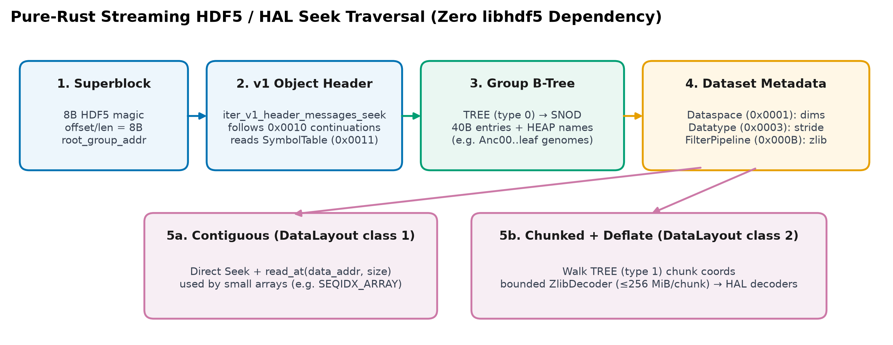
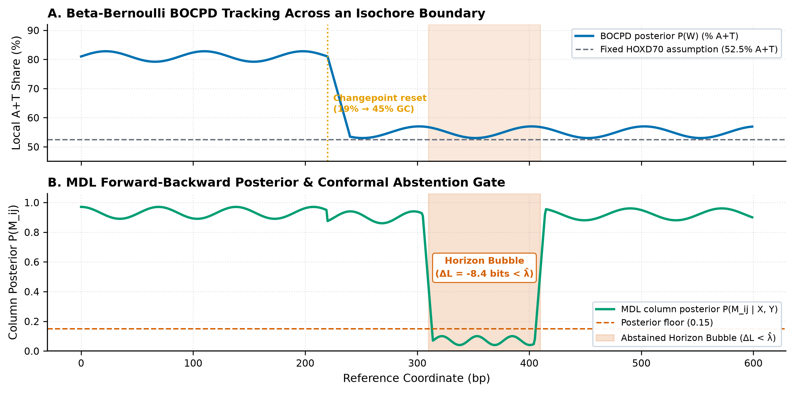
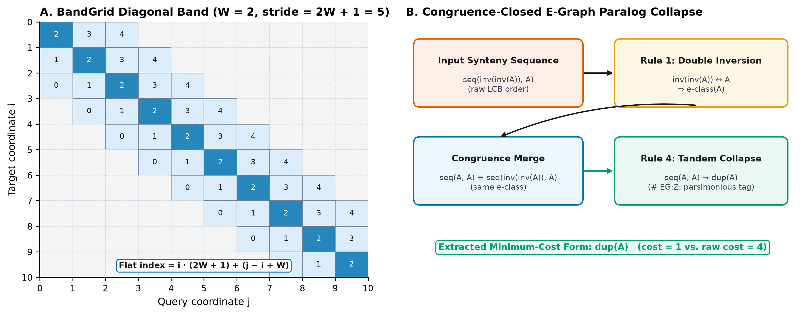

# 1. Purpose and Scope

This companion document provides the data-format specifications, mathematical derivations, and step-by-step implementation details underlying the Horizon whole-genome aligner (`https://github.com/richard-burhans/horizon-aligner`). While the main manuscript focuses on biological motivation, system architecture, and empirical benchmarks, this reference is designed for engineers, reviewers, and contributors inspecting the Rust library and CLI binaries:

| Module / Binary | Responsibility |
| :--- | :--- |
| `src/lib.rs` | Public API re-exports and shared alignment configuration |
| `src/seeding.rs` | `KP-14` Eisenstein hashing, `LASTZ`/`RY`/`W` masks, 6-frame AA seeds, `is_low_complexity_window`, `LIS` chaining, LCB clustering, uncovered-gap fallback |
| `src/bocpd.rs` | Beta-Bernoulli Bayesian Online Changepoint Detection (`bocpd_gc_profile`) |
| `src/mdl.rs` | Flat `BandGrid`, three-state MDL forward-backward DP, search-space scaling, conformal gate, X-drop flank extension |
| `src/merge.rs` | `O(N log N)` sweep-line `interval_match_score` netting, `thread_interval_columns`, transitive rescue |
| `src/formats.rs` | `MAF`, reference-anchored `rGFA`, and bidirectional `GFA` ↔ `MAF` lens round-trips |
| `src/egraph.rs` | Congruence-closed equality saturation for tandem duplications and nested inversions |
| `src/hal.rs` | Pure-Rust `Seek`-based HDF5 `v0`/`v1` parser and `HAL` binary array decoders |
| `src/bin/` | `horizon_wga`, `horizon_merge`, `horizon_guide`, `horizon_bench`, `horizon_hal` |

---

# 2. Data Representations and Wire Formats

## 2.1 Pairwise and Multi-Species `MAF`

Horizon emits standard `##maf version=1` alignment blocks:

```text
a score=184.2
s Pf3D7_01_v3   12040 42 + 638193 AATTGCATATCGCCGGTTAA--CCGTAATATCGGAT...
s Pr_01         11890 44 + 584285 AATTGCATATCGCCGGTTAAAACCGTAATATCGGAT...
```

- **Coordinates:** `start` is 0-based on the reported `strand` (`+` or `-`). For `-` strand rows, `start` is measured from the reverse-complemented sequence start (`seq_len - (fwd_start + size)`), matching UCSC/Galaxy `MAF` conventions.
- **Interval netting (`horizon_merge`):** When multiple pairwise blocks overlap on the reference coordinate space, `interval_match_score` scores each interval by exact matches minus mismatch/gap penalties and retains the highest-scoring non-overlapping tiling before threading query insertion columns (`thread_interval_columns`).

## 2.2 Reference-Anchored `rGFA` and Lens Metadata

Graph outputs (`horizon_wga --gfa` and `horizon_merge`) use GFA v1.1 / `rGFA` conventions:

- **Segment (`S`) lines:** Carry sequence and reference-coordinate tags:
  - `SN:Z:<seq_name>` — source contig or chromosome name.
  - `SO:i:<offset>` — 0-based start offset on `SN`.
  - `SR:i:0` — rank `0` for reference-backbone segments.
- **Horizon Bubble (`# HB:Z:`) annotations:** Unaligned intervals where `ΔL < λ̂` or inter-LCB spans exceed the dynamic-programming ceiling are emitted as explicit bubble records carrying `(ref_start, ref_end, qry_start, qry_end, reason)` rather than forced base-by-base alignments.
- **E-Graph Paralog (`# EG:Z:`) annotations:** Collapsed tandem duplications and nested inversions resolved by `src/egraph.rs` are recorded as `# EG:Z:` tags so downstream tools can distinguish collapsed paralogs from single-copy synteny.
- **Bidirectional `GFA` ↔ `MAF` Lens:** Viewing `MAF` as an asymmetric view `A = get(C)` of the full homology graph `C` (which also stores bubbles, paralogs, and non-reference blocks), edits on the `MAF` side map back via `putback(A', C)` while obeying three lens laws:
  1. **GETPUT:** `putback(get(C), C) == C`.
  2. **PUTGET:** `get(putback(A', C)) == A'`.
  3. **Constant Complement:** `# HB:Z:` bubbles, `# EG:Z:` paralogs, and non-reference blocks are preserved unchanged across round-trips.

## 2.3 Pure-Rust `Seek`-Based HDF5 and `HAL` Binary Layout (`src/hal.rs`)

`HAL` files (Hickey et al. 2013) are HDF5 containers storing a phylogenetic tree and per-genome sequence/segment tables. Reading multi-gigabyte `HAL` archives into RAM before parsing fails on large vertebrate panels (`363-avian`, `241-mammalian`). `src/hal.rs` therefore implements a zero-`libhdf5`, streaming `Read + Seek` HDF5 `v0`/`v1` reader (`BufReader<File>`):



**Figure C1. Pure-Rust streaming HDF5/`HAL` traversal via `Read + Seek`.** Horizon navigates from the HDF5 Superblock through `v1` Object Headers (following `0x0010` continuation blocks), Group B-Trees (`TREE` type `0` / `SNOD` / `HEAP`), and Dataset Metadata messages (`0x0001`, `0x0003`, `0x000B`) to read either contiguous slices or chunked `zlib`-compressed blocks on demand. Visual dictionary: blue indicates container headers, green indicates group symbol tables, orange indicates dataset metadata, and purple indicates contiguous versus chunked payload extraction.

1. **HDF5 Superblock (`read_hdf5_superblock_seek`):** Reads the first `96` bytes at offset `0`, checks the 8-byte magic signature (`89 48 44 46 0d 0a 1a 0a`), `offset_size`, `length_size`, and `root_group_addr`.
2. **Object Header & Continuation Traversal (`iter_v1_header_messages_seek`):** Walks `v1` object headers by seeking directly to each `hdr_addr`. Whenever an Object Header Continuation (`0x0010`) message appears, the iterator follows `(cont_offset, cont_length)` across non-contiguous file regions without loading unrelated datasets.
3. **Group Traversal (`read_hdf5_v0_group_entries_seek`):** Reads the `SymbolTable` (`0x0011`) message in any group's `v1` object header to locate its `TREE` (B-tree `v1`, type `0`), `SNOD` symbol-table nodes (40-byte entries containing `(name_off, obj_hdr_addr)`), and `HEAP` local string heap.
4. **Dataset Streaming (`read_hdf5_v0_dataset_bytes_seek`):**
   - Inspects `Dataspace` (`0x0001`) for rank and dimensions, `Datatype` (`0x0003`) for fixed element width, and `FilterPipeline` (`0x000B`) for `zlib` deflate (`filter_id == 1`).
   - For contiguous `DataLayout` (`0x0008`, class `1`), seeks directly to `data_addr` and reads `total_bytes`.
   - For chunked `DataLayout` (`0x0008`, class `2`), walks `TREE` type `1` chunk B-trees, decompresses each chunk via `flate2::read::ZlibDecoder` bounded at `256 MiB` per chunk, and copies valid coordinates into the output buffer.
5. **HAL Binary Record Decoders:**

| HAL Dataset | Record Width | Binary Field Layout (Little-Endian) | Decoder |
| :--- | :--- | :--- | :--- |
| `DNA_ARRAY` | 4 bits / base | High nibble first: `0..3` = `a,c,g,t`, `8..11` = `A,C,G,T`, `4` = `n`, else `N` | `decode_hal_dna` |
| `SEQIDX_ARRAY` | `24` bytes | `(start: u64, top_offset: u64, bottom_offset: u64)` | `decode_hal_seq_index` |
| `SEQNAME_ARRAY` | `stride` bytes | Fixed-width null-terminated ASCII/UTF-8 string | `decode_hal_seq_names` |
| `TOP_ARRAY` | `33` bytes | `(genome_idx: i64, bottom_idx: i64, paralogy_idx: i64, parent_idx: i64, rev: u8)` | `decode_hal_top_array` |
| `BOTTOM_ARRAY` | `24 + 9C` bytes | `(start: i64, len: u64, top_parse: i64)` + `C` × `(child_idx: i64, rev: u8)` | `decode_hal_bottom_array` |

---

# 3. Mathematical and Algorithmic Foundations

## 3.1 Strand-Symmetric `KP-14` Eisenstein Seeding and Repeat Filtering (`src/seeding.rs`)

To avoid canonicalizing forward and reverse-complement *k*-mers separately, Horizon encodes nucleotides over the quadratic extension field **F**_{q²} (*q* = 2⁶¹ − 1) using sixth-root Eisenstein units:

```text
φ(A) = 1,   φ(T) = -1,   φ(C) = ω,   φ(G) = -ω
```

Because Watson–Crick complements map to exact algebraic negatives (`φ(b̄) = −φ(b)`), the forward polynomial `F` and reverse-complement polynomial `R` over any spaced-seed mask `M` satisfy `(F + λ)(R + λ)` invariance under strand reversal.

Step-by-step seeding pipeline on target `X` (length `N`) and query `Y` (length `M`):

1. **Low-Complexity Window Guard (`is_low_complexity_window`):** Before hashing any spaced seed, Horizon checks the spanned window for homopolymer dominance (`max_base_count >= len * 3 / 4`) or dinucleotide periodicity (`di_count_01 >= len * 3 / 8`). Filtering simple AT-rich microsatellites and poly-A tracts at indexing time prevents `O(k²)` seed-hit explosions on `~3 Mb` mammalian and *Plasmodium* contigs without any genome-specific repeat masker.
2. **Multi-Tier Seed Vocabulary:**
   - **Exact spaced seeds:** `KP-14` masks at weight `12` (`MASK_W12`, span `15`) and uncovered-gap fallback weight `10` (`MASK_W10`, span `13`, activated only on regions left uncovered by `w = 12` LCBs).
   - **Transition seeds:** `MASK_LASTZ11` (1 transition) and `MASK_LASTZ12` (*T* ∈ {1, 2} transitions), gated by ungapped high-scoring pair (HSP) extension.
   - **Reduced-alphabet seeds:** `MASK_RY20` (purine/pyrimidine) and `MASK_W10` (weak/strong H-bond), activated on HSP-supported regions.
   - **Six-frame biochemical amino-acid seeds (`5-of-6`):** Translates all six reading frames into 9 biochemical equivalence classes (`aa_group`) to recover coding homology where synonymous third-codon positions have saturated.
3. **Chaining and LCB Clustering:** Forward and reverse-complement seed hits are chained separately in `O(M log M)` time via Longest Increasing Subsequence (LIS) dynamic programming (`lis_chain`), then grouped by diagonal consistency into locally collinear blocks (`cluster_strand_lcbs`).

## 3.2 Online Compositional Tracking (`BOCPD`, `src/bocpd.rs`)

Instead of fixed sliding windows or vertebrate-trained matrices (`HOXD70`), Horizon models local AT/GC composition along the binary weak/strong channel `x_t ∈ {0, 1}` (`1` for `A/T`, `0` for `G/C`) using Beta-Bernoulli Bayesian Online Changepoint Detection (Adams & MacKay 2007). At each position *t*, the run-length distribution `P(r_t | x_{1:t})` updates recursively with constant hazard *h*:

```text
P(r_t = r_{t-1} + 1, x_{1:t}) ∝ (1 - h) · P(r_{t-1}, x_{1:t-1}) · π(x_t | r_{t-1})
P(r_t = 0,         x_{1:t}) ∝ h · Σ_{r_{t-1}} P(r_{t-1}, x_{1:t-1}) · π(x_t | r_{t-1})
```

where the Beta-Bernoulli predictive probability `π(x_t = 1 | r) = (α_0 + s_r) / (α_0 + β_0 + r)` adapts smoothly inside homogeneous isochores and resets immediately at sharp `18%` ↔ `45%` GC boundaries.



**Figure C2. Online BOCPD tracking across an isochore boundary drives calibrated MDL abstention.** **A.** Local A+T share (`P(W)`) estimated online by Beta-Bernoulli BOCPD resets cleanly at an abrupt `19%` → `45%` GC boundary (`t ≈ 220 bp`), whereas a fixed `HOXD70` prior (`52.5%` A+T) miscalibrates the `~81%`-AT left isochore. **B.** Three-state MDL column posteriors `P(M_ij | X, Y)` remain near `0.90–0.97` across conserved flanks and collapse below the `0.15` floor inside an unalignable loop (`310–410 bp`), triggering an explicit Horizon Bubble (`ΔL = −8.4 bits < λ̂`). Visual dictionary: blue shows BOCPD `P(W)`, orange marks the changepoint reset, green shows MDL column posteriors, and shaded vermilion marks the abstained Horizon Bubble.

## 3.3 Continuous Search-Space MDL Scaling and `BandGrid` (`src/mdl.rs`)

For each candidate anchor or inter-anchor gap (`X` of length `N`, `Y` of length `M`), Horizon evaluates a three-state Minimum Description Length pair-HMM (`M` match/mismatch, `I` insertion, `D` deletion) in log-space (`logplus`), parameterized by the local BOCPD base frequencies:

- **Joint description length:** `L_joint = −log₂ P(X, Y | aligned)`
- **Local null description length:** `L_null = −log₂ P_BOCPD(X) − log₂ P_BOCPD(Y)`
- **Bit savings:** `ΔL = L_null − L_joint`
- **Per-column posterior:** `P(M_ij | X, Y) = exp(α_M(i, j) + β_M(i, j) − log P(X, Y))`

**Continuous Karlin–Altschul search-space scaling:** In a pairwise comparison of total lengths `L_ref` and `L_qry`, random background matches occur with expectation proportional to `L_ref · L_qry`. Rather than hardcoding step-function cutoffs for small versus large contigs, Horizon computes the continuous search-space information penalty:

```text
search_space_bits = 0.55 · log₂(max(L_ref, 1) · max(L_qry, 1))
```

This scales smoothly from `~7.3` bits on `100 bp` windows up to `~23.7` bits on `3 Mb × 3 Mb` chromosomes, raising the effective significance floor (`λ_eff = max(λ̂, search_space_bits)`) naturally with sequence size.

**Contiguous `BandGrid` layout:** To eliminate Python's sparse-dictionary bottleneck (`34.2%` of prototype runtime), forward (`α`) and backward (`β`) tables are stored in a single flat `Vec<f64>` of stride `S = 2W + 1` (default `band_w = 180`). For target index `i` and query index `j` within `|j − i| ≤ W`, the flat buffer index is:

```text
idx(i, j) = i · (2W + 1) + (j − i + W)
```

where `j − i + W ∈ [0, 2W]` maps the main diagonal `j = i` to column `W` in every row (Figure C3A).



**Figure C3. Flat `BandGrid` diagonal memory layout and congruence-closed e-graph paralog collapse.** **A.** `BandGrid` maps diagonal coordinates `(i, j)` with `|j − i| ≤ W` into a contiguous `Vec<f64>` of stride `2W + 1` (`W = 2`, stride `5` shown), placing the main diagonal at offset `W` (`2`). **B.** E-graph equality saturation applies `inv(inv(A)) ↔ A` and congruence closure to merge `seq(inv(inv(A)), A)` with `seq(A, A)` before collapsing tandem duplications (`seq(A, A) → dup(A)`) at minimum parsimony cost. Visual dictionary: dark blue marks the main diagonal `j = i`, light blue marks off-diagonal band cells, and green marks the extracted minimum-cost e-graph expression.

## 3.4 Conformal Risk Control and Horizon Bubbles (`src/mdl.rs`)

Horizon treats alignment emission as a calibrated statistical decision. Using Conformal Risk Control (Angelopoulos et al. 2024) at risk level `α = 0.07` (`n_cal = 15`), any block or gap whose bit savings falls below `λ̂ = 10.0` bits (or the search-space floor `λ_eff`)—or whose column posterior drops below `0.15`—is withheld from base-level alignment and emitted as a **Horizon Bubble**.

## 3.5 E-Graph Resolution, Sweep-Line Merge, and Transitive Guide Rescue

1. **Congruence-Closed E-Graph (`src/egraph.rs`):** Represents LCB sequences as e-classes (Willsey et al. 2021) and saturates four non-destructive algebraic rewrites:
   - `inv(inv(X)) <-> X` (double-inversion cancellation).
   - `inv(seq(A, B)) <-> seq(inv(B), inv(A))` (anti-homomorphic reversal).
   - `seq(seq(A, B), C) <-> seq(A, seq(B, C))` (associativity).
   - `seq(X, X) -> dup(X)` (tandem duplication collapse).
   Bottom-up parsimony extraction then selects `dup(X)`. This recovers duplicated and inverted regions that greedy 1-to-1 synteny filters discard (Figure C3B).
2. **`horizon_merge` Sweep-Line (`src/merge.rs`):** Sorts all pairwise intervals by reference start in `O(N log N)` time. It applies `interval_match_score` netting to resolve overlapping chains into a non-overlapping backbone, then runs `thread_interval_columns` to insert shared gap columns across all taxa simultaneously.
3. **`horizon_guide` Transitive Rescue (`src/bin/horizon_guide.rs`):** Aligns sister taxa progressively along a Newick guide tree. It applies `rescue_transitive_maf`—using an intermediate sibling with high pairwise identity to bridge divergent outgroup intervals—before ancestral consensus construction.

---

# 4. Worked Toy Example (22 bp Trace)

Consider a 22 bp *Plasmodium*-like pair with a complex AT-rich left flank (`25%` GC, avoiding pure homopolymers so `is_low_complexity_window` retains the seed), a 6 bp unalignable divergent insert, and a 4 bp conserved right flank:

- **Target `X` (22 bp):** `AATTGCATATCG` `GGGGCC` `ATCG`
- **Query `Y` (22 bp):** `AATTGCATATCG` `CCTTTT` `ATCG`

1. **Low-Complexity Check & Seeding:** In the 12 bp prefix `AATTGCATATCG`, the maximum single-base count is `4` (`A`/`T`, `< 12 * 3 / 4 = 9`) and dinucleotide periodicity is below threshold, so `is_low_complexity_window` passes. `KP-14` (`w = 10`) anchors the identical `0..12` prefix and `18..22` suffix. This leaves a `6 bp` inter-anchor gap (`X[12..18] = GGGGCC` vs. `Y[12..18] = CCTTTT`).
2. **BOCPD Tracking:** Over `X[0..12]` (`75%` A/T), `bocpd_gc_profile` estimates `P(W) ≈ 0.72`. At `X[12] = G`, the changepoint hazard shifts `P(W)` downward across the GC-rich insert.
3. **Banded MDL Scoring (`BandGrid`):**
   - For the `6 bp` gap (`band_w = 180`), `BandGrid` allocates `(6 + 1) × (2 · 180 + 1)` floats and evaluates `idx(i, j) = i · 361 + (j − i + 180)` in `O(1)` per cell.
   - On the conserved prefix (`12 bp`), matching all 12 bases under `P(W) ≈ 0.72` yields `ΔL ≈ +17.8` bits (`≥ λ̂ = 10.0` bits) with column posteriors `P(M_ij) > 0.95`.
   - Inside the `6 bp` gap (`GGGGCC` vs. `CCTTTT`), 0 of 6 bases match, giving `ΔL ≈ −6.4` bits (`< 10.0` bits) and `P(M_ij) < 0.15`.
4. **Conformal Gate & Output:** Horizon emits the aligned `MAF` blocks for `0..12` and `18..22`, and isolates `12..18` as an explicit `# HB:Z:` **Horizon Bubble** in the `GFA` graph rather than forcing 6 mismatched bases into a false alignment.

---

# 5. References {.unnumbered}

- **Adams RP & MacKay DJC** (2007). Bayesian online changepoint detection. *arXiv preprint* `arXiv:0710.3742`.
- **Allison L, Wallace CS, Yee CN** (1992). Finite-state models in the alignment of macromolecules. *Journal of Molecular Evolution*, 35(1):77–89.
- **Angelopoulos AN, Bates S, Fisch A, Lei L, Schuster T** (2024). Conformal risk control. *ICLR 2024* (`arXiv:2208.02814`).
- **Foster JN, Greenwald MB, Moore JT, Pierce BC, Schmitt A** (2007). Combinators for bidirectional tree transformations: A linguistic approach to the view-update problem. *ACM TOPLAS*, 29(3):17.
- **Hickey G, Paten B, Earl D, Zerbino D, Haussler D** (2013). HAL: a hierarchical format for storing and analyzing multiple genome alignments. *Bioinformatics*, 29(10):1341–1342.
- **Willsey M, Nandi C, Wang YR, Flatt O, Tatlock Z, Panchekha P** (2021). egg: Fast and extensible equality saturation. *PACMPL*, 5(POPL):1–29.
