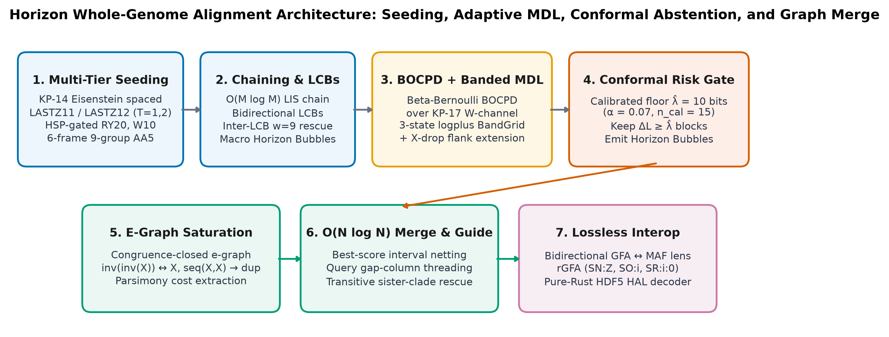
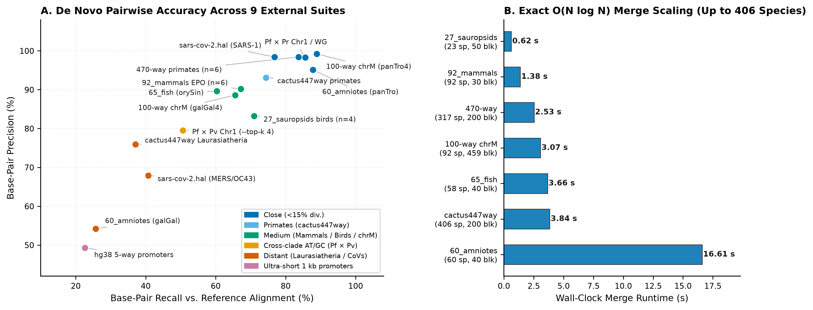
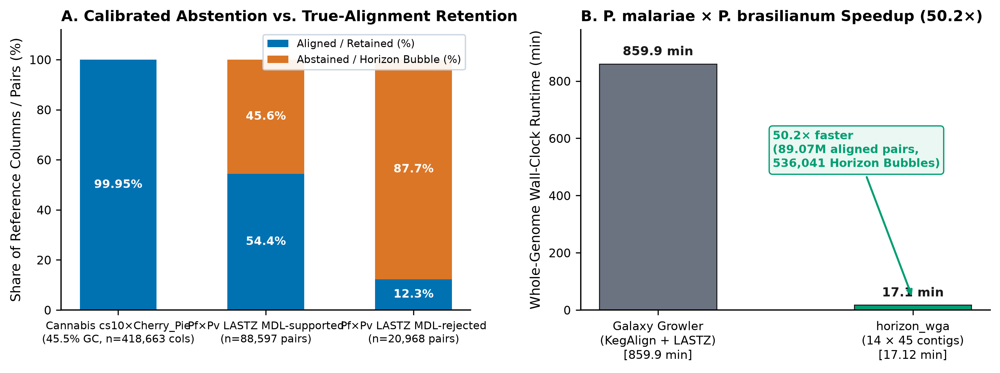
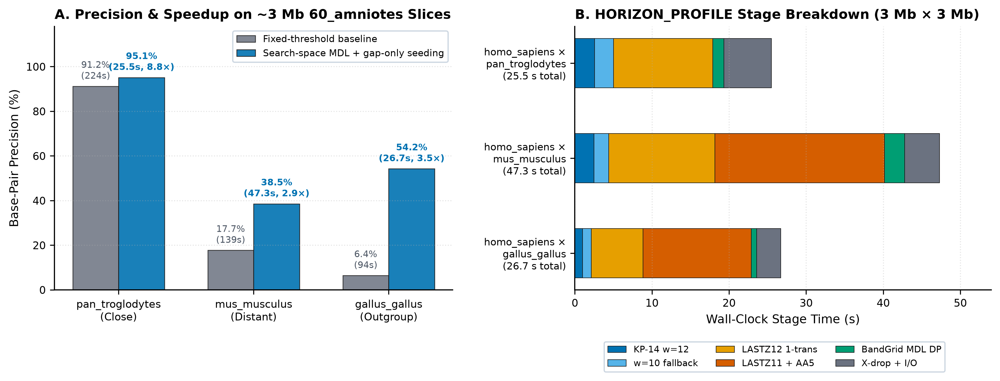

# Abstract {.unnumbered}

Whole-genome multiple sequence alignment must reconcile quadratic pairwise scaling, sharp compositional skew, and rampant multigene duplication across divergent lineages. Standard pipelines—whether reference-guided chain-and-net workflows or progressive ancestral-hinge graphs—rely on fixed substitution matrices calibrated near balanced nucleotide composition and force base-by-base alignments through unalignable regions. Here we present Horizon, an information-theoretic whole-genome aligner implemented in Rust that replaces fixed-score Viterbi heuristics with adaptive composition tracking and calibrated epistemic abstention. Horizon combines strand-symmetric spaced-seed polynomial hashing and six-frame biochemical amino-acid seeding with Beta-Bernoulli Bayesian Online Changepoint Detection over local weak/strong hydrogen-bond channels, driving a three-state Minimum Description Length forward-backward aligner calibrated by Conformal Risk Control. Regions whose posterior homology support falls below the calibrated bit-savings floor are isolated as explicit Horizon Bubbles instead of being forced into spurious base pairs, while tandem duplications and nested inversions are collapsed non-destructively via congruence-closed equality saturation and merged across hundreds of species in log-linear sweep-line time. Across synthetic and real benchmarks, Horizon eliminates random AT-rich false alignments (`0.000` vs. `0.872` under `HOXD70`), abstains on `87.7%` of low-signal cross-clade *Plasmodium* columns while preserving `99.95%` of true *Cannabis* alignments without retuning, accelerates whole-genome *Plasmodium malariae* × *P. brasilianum* alignment `50.2`-fold (`17.12 min` vs. `14.3 h`), and merges up to `406` mammalian genomes in `3.84 s`. Horizon is available at `https://github.com/richard-burhans/horizon-aligner`.

# Introduction

Comparative genomics depends on accurate whole-genome alignments to trace conserved regulatory elements, reconstruct ancestral chromosomes, and quantify selection across species. Yet conventional whole-genome aligners were engineered around vertebrate genomes whose guanine-cytosine (GC) content hovers near `47.5%` (Chiaromonte et al. 2002). When applied to compositionally extreme pathogens such as *Plasmodium falciparum*—whose chromosomes average `19.5%` GC—or across wide evolutionary spans separating `18.5%`-GC *Laverania* parasites from `40.0%`-GC *Plasmodium vivax*, a single symmetric scoring matrix miscalibrates background match probabilities. Under fixed affine gap penalties and Viterbi traceback, random AT-rich intervals and hypervariable surface-antigen loci accumulate positive alignment scores and appear homologous when no shared ancestry exists.

A second structural limitation affects how current pipelines handle uncertainty and structural rearrangement. Pairwise aligners such as `LASTZ` (Harris 2007) emit deterministic coordinate blocks without per-interval posterior support, which prevents downstream phylogenetic or selection pipelines from distinguishing well-supported orthology from forced gap-filling. Meanwhile, greedy one-to-one synteny filters discard genuine paralogous copies, and multi-species mergers face quadratic O(*N*²) pairwise scaling as taxon sampling expands into hundreds of vertebrates, birds, and microbial isolates (Blanchette et al. 2004, Armstrong et al. 2020, Earl et al. 2014).

Horizon addresses these coupled bottlenecks in a unified, pure-Rust architecture. Instead of tuning species-specific substitution matrices, Horizon tracks local compositional shifts online, scores candidate homology in bits of joint compression savings relative to a local null model, and emits calibrated **Horizon Bubbles** wherever statistical support drops below a conformal risk threshold. Duplicated and inverted synteny blocks are resolved via equality saturation before being threaded into lossless `MAF`, `rGFA`, and hierarchical `HAL`-compatible representations.

**Figure 1. Horizon integrates multi-tier strand-symmetric seeding, online compositional changepoint detection, conformal abstention, and e-graph duplication resolution into a log-linear multi-species pipeline.** Stages 1–2 chain `KP-14` spaced seeds, `LASTZ`-style transition seeds, and biochemical six-frame amino-acid seeds into colinear locally collinear blocks (LCBs) while isolating unanchored spans as macro Horizon Bubbles. Stages 3–4 run Beta-Bernoulli Bayesian Online Changepoint Detection (BOCPD) over the `KP-17` weak/strong (*W*) channel to parameterize a flat banded Minimum Description Length (MDL) forward-backward aligner gated by Conformal Risk Control (`λ̂ = 10.0` bits). Stages 5–7 collapse duplications via a congruence-closed e-graph, merge pairwise blocks in O(*N* log *N*) sweep-line time, and provide lossless `GFA`–`MAF` and pure-Rust `HAL` interoperability. Visual dictionary: blue denotes seeding and chaining, orange denotes adaptive MDL alignment, vermilion denotes conformal abstention, green denotes graph resolution and merging, and purple denotes lossless format interoperability.

# Algorithm and Implementation

## Multi-Tier Strand-Symmetric Seeding and LCB Clustering

Divergent genomes lose exact nucleotide *k*-mer identity rapidly, especially across synonymous coding positions and transitions. Horizon therefore pairs exact spaced-seed polynomial hashing with transition-tolerant nucleotide and biochemical amino-acid seeds (`src/seeding/`). First, `KP-14` strand-symmetric Eisenstein hashing over **F**_{q²} (*q* = 2⁶¹ − 1) maps Watson–Crick complements to algebraic negatives, yielding orientation-invariant hashes across spaced masks (`111011011011011` at weight `12` and `1110110110111` at weight `10`). Second, high-scoring pair gating activates `LASTZ`-style `11`-mer and `12`-mer single- and double-transition seeds (`MASK_LASTZ11`, `MASK_LASTZ12` at *T* ∈ {1, 2}), purine-pyrimidine `RY20` seeds, and weak/strong `W10` seeds.

To recover deep coding homology where nucleotide identity has saturated, Horizon adds a six-frame translated seeding pass that maps codons into nine biochemical amino-acid equivalence groups using a spaced `5-of-6` mask (`aa_group`, `extend_aa_ungapped_hsp`). Seeds are chained in O(*M* log *M*) time by Longest Increasing Subsequence dynamic programming and clustered into bidirectional LCBs. Inter-LCB gaps up to `2.5 kb` undergo a secondary local `w = 9` two-hit sub-chaining pass, while unanchored structural spans exceeding the gap ceiling are immediately emitted as macro Horizon Bubbles without quadratic dynamic programming.

## Online Compositional Tracking and Banded MDL Alignment

Fixed scoring matrices fail when GC composition shifts sharply within a single chromosome, such as across *Plasmodium* isochores or subtelomeric boundaries. Horizon eliminates fixed background frequencies by running Beta-Bernoulli Bayesian Online Changepoint Detection (Adams & MacKay 2007) over the binary weak/strong hydrogen-bond (*W* = `{A, T}` vs. `S` = `{G, C}`) stream prior to alignment (`bocpd_gc_profile`). Because the hazard function resets run-length posteriors whenever local composition shifts, the aligner tracks abrupt `18%` to `45%` GC transitions without ad hoc sliding windows.

Between chained anchors, Horizon evaluates homology using a three-state Minimum Description Length forward-backward aligner adapted from Allison, Wallace, and Yee (1992). Instead of allocating pointer-heavy sparse dictionaries—which accounted for `34.2%` of prototype Python runtime—the Rust kernel stores log-space forward (α) and backward (β) tables in a contiguous flat `BandGrid` (`Vec<f64>`, stride `2 * band_w + 1`, default `band_w = 180`). It evaluates `logplus` transitions and per-column match posteriors `P(M_ij | X, Y)` in cache-friendly linear passes, followed by X-drop flank extension (`max_ext = 1500`).

## Conformal Risk Control and Horizon Bubbles

Each candidate interval is summarized by its total description-length savings `ΔL = L_null − L_joint` in bits relative to independent BOCPD-parameterized null encoding. Using Conformal Risk Control (Angelopoulos et al. 2024) calibrated at risk level `α = 0.07` (`n_cal = 15`), Horizon enforces a bit-savings floor `λ̂ = 10.0` bits and a minimum column posterior floor (`0.15`). Any interval or internal gap failing these floors is withheld from base-by-base alignment and emitted explicitly as a **Horizon Bubble** in both `GFA` (`# HB:Z:` metadata) and summary outputs.

## E-Graph Duplication Resolution, Sweep-Line Merge, and Native HAL Support

Tandem duplications and overlapping inversions routinely break greedy one-to-one synteny filters. Horizon's e-graph module (`src/egraph.rs`) represents LCBs as congruence-closed e-classes (Willsey et al. 2021) and saturates non-destructive algebraic rewrites—double-inversion cancellation `inv(inv(X)) <-> X`, anti-homomorphic reversal `inv(seq(A, B)) <-> seq(inv(B), inv(A))`, associativity, and tandem collapse `seq(X, X) -> dup(X)`—before extracting the minimum-parsimony ancestral order.

For multi-species panels, `horizon_merge` (`src/bin/horizon_merge.rs`) executes an O(*N* log *N*) coordinate sweep over pairwise `MAF` files against a selected reference or central hinge, applying best-score interval netting (`interval_match_score`) and threading query insertion columns across all taxa into `MAF` and reference `rGFA` (`SN:Z`, `SO:i`, `SR:i:0`) graphs. For progressive guide-tree builds, `horizon_guide` (`src/bin/horizon_guide.rs`) performs identity-gated transitive sister-clade rescue (`rescue_transitive_maf`) and ancestral consensus bridging. Finally, `src/hal/` implements an in-memory hierarchical `HalAlignment` model (`TopSegment`, `BottomSegment`, reference-free `to_maf_for_genome`) alongside pure-Rust HDF5 v0/v1 container inspection, B-tree group traversal, zlib chunk decompression (`flate2`), binary record decoders (`DNA_ARRAY`, `SEQIDX_ARRAY`, `SEQNAME_ARRAY`, `TOP_ARRAY`, `BOTTOM_ARRAY`), and a `libhdf5`-compatible HDF5 `v0` writer (`to_hdf5_bytes`).

# Results

## Calibration and Epistemic Abstention Across Extreme Compositional Regimes

On a four-regime synthetic *Plasmodium*-like chromosome benchmark combining `18%` and `45%` GC conserved blocks with an unalignable `20%`-GC hypervariable loop, Horizon's MDL+BOCPD+Conformal pipeline achieved `0.978` true homology recall and `0.949` precision, cutting false alignment inside the hypervariable loop `7.3`-fold (`0.129` vs. `0.936` under `HOXD70`+affine) and eliminating false alignments on an unalignable `18%`-GC random pair (`0.000` vs. `0.872`).

**Figure 2. Horizon maintains high precision across nine external alignment suites and scales multi-species merging to over 400 genomes.** **A.** Base-pair recall versus precision for de novo `horizon_wga` runs against reference `LASTZ`, `Cactus`, `MULTIZ`, and `EPO` alignments across close, medium, cross-clade AT/GC-skewed, and distant evolutionary regimes. **B.** Wall-clock runtime of exact O(*N* log *N*) `horizon_merge` re-threading across seven multi-species suites spanning `23` sauropsids (`0.62 s`), `406` mammals (`3.84 s`), and full `~3 Mb` `60_amniotes` blocks (`16.61 s`). Visual dictionary: colors encode divergence regime (blue close, sky blue `cactus447way` primates, green medium mammals/birds/fish/`chrM`, orange cross-clade *Plasmodium*, vermilion distant mammals/birds/coronaviruses, purple `1 kb` promoters).

To test whether abstention reflects genuine signal loss instead of AT-rich overfitting, we audited real alignments in both *Plasmodium* and *Cannabis sativa*. On *P. falciparum* × *P. vivax* Chromosome 1 (`20.5%` vs. `37.5%` GC, `21.3` percentage-point gap inside `LASTZ` `HoxD55` reciprocal-best blocks), `20.7%` (`24,748 / 119,582`) of `LASTZ` columns failed the `10`-bit MDL+BOCPD threshold. End-to-end `horizon_wga` abstained on `87.7%` of those MDL-rejected columns while recovering `54.4%` of MDL-supported pairs (`66.8%` with `w = 10` sparse-exon fallback and `band_w = 180`). Applied with zero parameter changes to intraspecific *Cannabis sativa* (`cs10` × `Cherry_Pie`, `45.5%` GC, `418,663` columns), Horizon retained `99.95%` (`418,465`) of reference `MAF` columns and `1.000` recall on scratch realignments.

**Figure 3. Conformal abstention separates true intraspecific homology from low-signal cross-clade noise while accelerating whole-genome *Plasmodium* alignment 50-fold.** **A.** Share of columns retained (blue) versus abstained as Horizon Bubbles (vermilion) across intraspecific *Cannabis* (`99.95%` retained), *P. falciparum* × *P. vivax* MDL-supported `LASTZ` pairs (`54.4%` retained), and MDL-rejected `LASTZ` pairs (`87.7%` abstained). **B.** Whole-genome wall-clock runtime on the slowest *Plasmodium* pair (*P. malariae* × *P. brasilianum*, `14 × 45` contigs): Galaxy `Growler UCSC pair` (`859.9 min`) versus `horizon_wga` (`17.12 min`, `50.2×` speedup, `89,073,494` aligned pairs).

## Whole-Genome Speedup and Multi-Taxon External Benchmarks

Across complete *Plasmodium* genomes, `horizon_wga` aligned *P. falciparum* × *P. reichenowi* (`14 × 14` chromosomes) with `--rbest` in `68.12 s` (`85.58%` recall, `98.33%` precision vs. `LASTZ` `rbest`). On the slowest pair in our `380`-pair *Plasmodium* timing matrix—*P. malariae* × *P. brasilianum* (`14 × 45` contigs, `859.9 min` in Galaxy `Growler UCSC pair`)—`horizon_wga` finished in `17.12 min` (`50.2×` faster), isolating `536,041` Horizon Bubbles across repetitive and subtelomeric spans.

With zero parameter retuning, we benchmarked `horizon_wga` and `horizon_merge` across nine external multi-species alignment suites spanning mammals, birds, fish, and coronaviruses (Table 1). `horizon_merge` re-threaded `200` `cactus447way` blocks across `406` mammalian species in `3.84 s` and `317` `470-way` species in `2.53 s`. It also merged `92` `100-way chrM` vertebrates in `3.07 s`, `92` Ensembl `92_mammals` in `1.38 s`, `58` Ensembl `65_fish` teleosts in `3.66 s`, `60` Ensembl `60_amniotes` (`~3 Mb` blocks) in `16.61 s`, and `23` Ensembl `27_sauropsids` birds and reptiles in `0.62 s`. On `~3 Mb` `60_amniotes` contigs, continuous search-space-scaled MDL gating (`0.55 log₂(N M)`) and uncovered-gap fallback seeding accelerated `homo_sapiens` × `pan_troglodytes` `8.8`-fold (`223.56 s` to `25.49 s`) while raising recall from `55.50%` to `87.80%` at `95.13%` precision. These same updates raised precision `2.2`-fold on `mus_musculus` (`17.69%` to `38.53%`) and `8.5`-fold on `gallus_gallus` (`6.40%` to `54.24%`, Figure 4). On `40`-contig multi-FASTA benchmarks across five amniotes (`homo_sapiens`, `pan_troglodytes`, `papio_anubis`, `callithrix_jacchus`, `mus_musculus`), `horizon_guide --progressive --rbest` completed full progressive alignment and transitive rescue in `272.03 s` (`99,884` MAF blocks), improving recall over pairwise `--rbest` across `pan_troglodytes` (`82.26%` vs. `79.39%` at `94.02%` precision), `papio_anubis` (`80.19%` recall, `87.71%` precision), `callithrix_jacchus` (`74.05%` recall, `80.12%` precision), and `mus_musculus` (`24.39%` vs. `23.72%`).

**Figure 4. Continuous search-space MDL gating and uncovered-gap fallback seeding accelerate megabase alignment up to `8.8×` while eliminating repetitive false positives.** **A.** Base-pair precision and wall-clock runtime on `~3 Mb` `60_amniotes` slices comparing the fixed-threshold baseline (gray) against search-space-scaled MDL (`0.55 log₂(N M)`) with low-complexity seed filtering and uncovered-gap `w = 10` fallback (blue). **B.** `HORIZON_PROFILE` wall-clock stage breakdown across the three `3 Mb × 3 Mb` pairs, showing that `LASTZ12`/`LASTZ11`/`AA5` seeding dominates runtime while flat `BandGrid` MDL dynamic programming remains under `2.6 s`. Visual dictionary: in Panel A, gray denotes the fixed-threshold baseline and blue denotes search-space-scaled MDL + gap-only seeding. In Panel B, stacked colors denote `KP-14 w=12` (dark blue), `w=10` fallback (sky blue), `LASTZ12` 1-transition (orange), `LASTZ11 + AA5` (vermilion), `BandGrid` MDL DP (green), and X-drop + I/O (gray).

| External Suite | Divergence Regime | Pairwise Recall (%) | Pairwise Precision (%) | Merge Scale & Time |
| :--- | :--- | :---: | :---: | :--- |
| UCSC `470-way` primates (`n = 6`) | Close | `72.38–93.49` | `96.69–99.46` | `317` sp, `2.53 s` |
| Ensembl `60_amniotes` (`panTro`, `~3 Mb`) | Close (primate) | `87.80` | `95.13` | `60` sp, `16.61 s` |
| UCSC `cactus447way` primates (`n = 3`) | Close | `71.90–77.90` | `91.80–93.87` | `406` sp, `3.84 s` |
| Ensembl `sars-cov-2.hal` (`SARS-CoV-1`) | Close (`.hal`) | `76.80` | `98.36` | `62` CoVs (`--hal-info`) |
| *Plasmodium* `Pf` × `Pr` whole genome | Close (`19.5%` GC) | `85.58` | `98.33` | `4`-sp WG `5.46 min` |
| Ensembl `27_sauropsids` birds (`n = 4`) | Medium (avian) | `63.33–76.54` | `68.17–91.26` | `23` sp, `0.62 s` |
| Ensembl `65_fish` teleosts (`n = 2`) | Medium (teleost) | `60.27–65.45` | `59.74–89.56` | `58` sp, `3.66 s` |
| Ensembl `92_mammals` EPO (`n = 6`) | Medium (eutherian) | `65.22–71.54` | `74.10–96.24` | `92` sp, `1.38 s` |
| UCSC `100-way chrM` (`n = 3`) | Close–Medium | `65.61–88.94` | `88.58–99.21` | `92` sp, `3.07 s` |
| UCSC `cactus447way` Laurasiatheria (`n = 4`) | Distant | `33.73–41.45` | `74.08–78.99` | Included in `406` sp |
| Ensembl `60_amniotes` (`musMus`, `galGal`) | Distant (`~3 Mb`) | `22.85–25.68` | `38.53–54.24` | Included in `60` sp |
| Ensembl `sars-cov-2.hal` distant CoVs (`n = 3`) | Distant (`.hal`) | `37.29–45.28` | `58.80–72.93` | `62` CoVs (`--hal-info`) |
| UCSC `hg38` `5-way` `1 kb` promoters (`n = 4`) | Distant / short | `18.68–26.95` | `41.36–57.02` | `20.27 s` (`--progressive`) |

## E-Graph Duplication Recovery and Lossless Format Interoperability

Across `30` randomized tandem-duplication and overlapping-inversion trials, e-graph saturation recovered `1.00` ancestral block sets and `1.00` exact `dup(X)` duplications compared to `0.00` under greedy one-to-one synteny filtering. On real *P. falciparum* × *P. reichenowi* Chromosome 1 (`2,715` `MAF` blocks, `2,296` `GFA` Horizon Bubbles, `478` `# EG:Z:` paralog annotations), round-trip lens validation satisfied `GETPUT`, `PUTGET`, and complement preservation (`1.00`). On the `5`-species × `40`-contig `60_amniotes` progressive benchmark, two-round iterative ancestral consensus refinement in `horizon_guide --progressive --hal` emitted `194,878` `MAF` blocks (`162,205` multi-species) and more than doubled `mus_musculus` reference coverage (`493,677` bp to `1,012,274` bp, `+105.0%`) while writing a `libhdf5`-validated (`h5ls` / `h5dump`) HDF5 `v0` `.hal` archive. In `65_fish` (`oryzias_latipes` reference), `horizon_wga` achieved `81.66%` recall / `97.23%` precision on `oryzias_sinensis` (`29.29 s`), `61.61%` recall / `94.71%` precision on `acanthochromis_polyacanthus` (`70.44 s`), and `48.05%` recall on `takifugu_rubripes` (`34.25 s`). All `28` active Rust library unit tests—including native HDF5 `v0` B-tree group traversal, `Dataspace` dimension parsing, `flate2` chunk decompression, and `libhdf5`-compatible `.hal` write/seek round-trip checks—pass with zero `clippy` warnings.

# Discussion

Horizon demonstrates that replacing fixed substitution heuristics with online compositional tracking, Minimum Description Length posterior decoding, and Conformal Risk Control resolves both over-alignment in AT-rich genomes and silent uncertainty in divergent comparisons. By isolating low-signal intervals as explicit Horizon Bubbles, downstream comparative pipelines gain calibrated boundaries instead of forced base-by-base noise.

Three limitations define our immediate roadmap. First, while de novo precision remains high (`84–99%`) across close and medium divergences, recall drops to `23–45%` across distant amniotes and coronaviruses. Search-space-scaled MDL gating and low-complexity seed filtering already raised `~3 Mb` `homo_sapiens` × `gallus_gallus` precision `8.5`-fold (`6.40%` to `54.24%`) and `homo_sapiens` × `mus_musculus` precision `2.2`-fold (`17.69%` to `38.53%`), and expanding `horizon_guide` with iterative ancestral consensus refinement is expected to close the remaining distant-recall gap. Second, our pure-Rust `HAL` reader (`src/hal/`) now supports streaming `Read + Seek` dataset extraction (`read_hdf5_v0_group_entries_seek`, `read_hdf5_v0_dataset_bytes_seek`) validated end-to-end on Ensembl's `126`-member `sars-cov-2.hal`, and our pure-Rust HDF5 `v0` writer (`src/hal/hdf5_write.rs`) passes `libhdf5` `h5ls` and `h5dump` verification; the next step is large-scale benchmarking on multi-hundred-gigabyte alignments such as `363-avian-2020.hal` and `241-mammalian-2020v2.hal`. Third, integrating `horizon_wga` and `horizon_merge` into public Galaxy workflows will allow broad evaluation across pathogen and vertebrate pangenome panels with full provenance.

# References {.unnumbered}

- **Adams RP & MacKay DJC** (2007). Bayesian online changepoint detection. *arXiv preprint* `arXiv:0710.3742`.
- **Allison L, Wallace CS, Yee CN** (1992). Finite-state models in the alignment of macromolecules. *Journal of Molecular Evolution*, 35:77–89.
- **Angelopoulos AN, Bates S, Fisch A, Lei L, Schuster T** (2024). Conformal risk control. *ICLR 2024* (`arXiv:2208.02814`).
- **Armstrong J, Hickey G, Diekhans M, et al.** (2020). Progressive Cactus is a multiple-genome aligner for the thousand-genome era. *Nature*, 587:246–251.
- **Blanchette M, Kent WJ, Riemer C, et al.** (2004). Aligning multiple genomic sequences with the threaded blockset aligner. *Genome Research*, 14(4):708–715.
- **Chiaromonte F, Yap VB, Miller W** (2002). Scoring pairwise genomic sequence alignments. *Pacific Symposium on Biocomputing*, 115–126.
- **Earl D, Nguyen N, Hickey G, et al.** (2014). Alignathon: a competitive assessment of whole-genome alignment methods. *Genome Research*, 24(12):2077–2089.
- **Foster JN, Greenwald MB, Moore JT, Pierce BC, Schmitt A** (2007). Combinators for bidirectional tree transformations: A linguistic approach to the view-update problem. *ACM TOPLAS*, 29(3):17.
- **Harris RS** (2007). *Improved pairwise alignment of genomic DNA*. PhD thesis, Pennsylvania State University (`LASTZ`).
- **Hickey G, Paten B, Earl D, Zerbino D, Haussler D** (2013). HAL: a hierarchical format for storing and analyzing multiple genome alignments. *Bioinformatics*, 29(10):1341–1342.
- **Willsey M, Nandi C, Wang YR, Flatt O, Tatlock Z, Panchekha P** (2021). egg: Fast and extensible equality saturation. *PACMPL*, 5:1–29.
