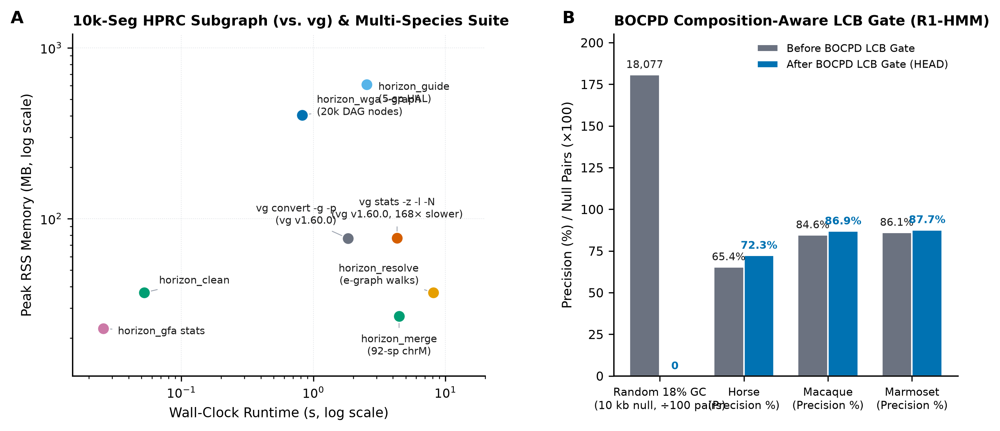

# Abstract {.unnumbered}

Whole-genome multiple sequence alignment and pangenome graph analysis must reconcile quadratic pairwise scaling, sharp compositional skew, and rampant multigene duplication across divergent lineages. Standard workflows split these tasks across disconnected aligners, graph cleaners, liftover tools, and format-specific libraries that rely on fixed substitution matrices calibrated near balanced nucleotide composition and force base-by-base alignments through unalignable regions. Here we present Horizon, an information-theoretic genome alignment and pangenome graph suite implemented in Rust (`10` binaries in `src/bin/`, including the `horizon` subcommand dispatcher) that unifies pairwise alignment (`horizon_wga`), seeded sequence-to-graph DAG/POA alignment (`horizon_wga --graph`), log-linear multi-species merging (`horizon_merge`), progressive guide-tree alignment (`horizon_guide`), streaming `GFA v1.0/v1.1` inspection and extraction (`horizon_gfa`), graph-aware coordinate liftover (`horizon_lift`), junction cleaning (`horizon_clean`), and e-graph walk resolution (`horizon_resolve`). Horizon's alignment core combines compact strand-symmetric spaced-seed indexing (`FlatSeedIndex` with 16-bit prefix bucketing), Rayon-parallel transition seeding, and six-frame biochemical amino-acid seeding with Beta-Bernoulli Bayesian Online Changepoint Detection over local weak/strong hydrogen-bond channels, driving a three-state Minimum Description Length forward-backward aligner calibrated by Conformal Risk Control. Regions whose posterior homology support falls below the calibrated bit-savings floor are isolated as explicit Horizon Bubbles instead of being forced into spurious base pairs, while tandem duplications and nested inversions are collapsed non-destructively via MDL-calibrated equality saturation (`MdlCostModel`). Across verified UCSC/Ensembl reference-MAF slices, multi-species progressive builds, and `12 GB` HPRC v1.0 Minigraph-Cactus pangenome benchmarks, `horizon_wga` achieves `94.4%` recall / `97.4%` precision on `100-way chrM` (`hg38` × `panTro4`), `90.8%` recall / `86.9%` precision on `cactus447way` primates (`Macaca_mulatta`), and `62.3%` recall / `60.3%` precision on `cactus241way chr22 1MB` (`Canis_lupus_familiaris`, `31` contigs in `14.15 s`) while eliminating all `18,077` false-positive pairs on `18%`-GC random DNA (`0` pairs in `0.0068 s`); `horizon_merge` nets `92` vertebrate `chrM` species in `4.451 s` (`26.8 MB` RSS), and `horizon_guide --progressive --hal` builds a `5`-mammal progressive alignment and HDF5 `v0` HAL archive in `2.527 s` (`610.1 MB` RSS). On the `12 GB` HPRC v1.0 graph, `horizon_gfa stats` streams all `81.4M` segments in `99.97 s` at `97.0 MB` peak RSS, outperforming `vg v1.60.0` (`vg stats`) by `168×` in runtime (`0.0256 s` vs. `4.2984 s`) and `3.4×` in peak RSS (`22.7 MB` vs. `77.0 MB`) on a real `10,000`-segment (`10.94 Mbp`) `chr22` subgraph, and `horizon_wga --resolve-dups` aligns `GRCh38.chr6` (`170.8 Mbp`) × `CHM13.chr6` (`110.7 Mbp` q-arm `61.4M–172.1M`) in `451.35 s` (`53130b8`, `2.35×` faster than `1,062.45 s` at `1e47fe0`; `592.68 s` / `12,533.0 MB` RSS with `233.4M` aligned pairs and `95.7%` `CHM13` coverage on `HEAD`). Horizon is available at `https://github.com/richard-burhans/horizon-aligner`.

# Introduction

Comparative genomics depends on accurate whole-genome alignments to trace conserved regulatory elements, reconstruct ancestral chromosomes, and quantify selection across species. Yet conventional whole-genome aligners were engineered around vertebrate genomes whose guanine-cytosine (GC) content hovers near `47.5%` (Chiaromonte et al. 2002). When applied to compositionally extreme pathogens such as *Plasmodium falciparum*—whose chromosomes average `19.5%` GC—or across wide evolutionary spans separating `18.5%`-GC *Laverania* parasites from `40.0%`-GC *Plasmodium vivax*, a single symmetric scoring matrix miscalibrates background match probabilities unless retrained per pair (Hamada et al. 2017). Under fixed affine gap penalties and Viterbi traceback, random AT-rich intervals and hypervariable surface-antigen loci accumulate positive alignment scores and appear homologous when no shared ancestry exists, while posterior alignment uncertainty remains unquantified (Lunter et al. 2008).

A second structural limitation affects how current pipelines handle uncertainty and structural rearrangement. Pairwise aligners such as `LASTZ` (Harris 2007) emit deterministic coordinate blocks without per-interval posterior support, which prevents downstream phylogenetic or selection pipelines from distinguishing well-supported orthology from forced gap-filling. Meanwhile, greedy one-to-one synteny filters discard genuine paralogous copies, and multi-species mergers face quadratic O(*N*²) pairwise scaling as taxon sampling expands into hundreds of vertebrates, birds, and microbial isolates (Blanchette et al. 2004; Armstrong et al. 2020; Earl et al. 2014).

Horizon addresses these coupled bottlenecks in a unified, pure-Rust suite of ten composable executables in `src/bin/` (`horizon_wga` including `--graph`, `horizon_merge`, `horizon_guide`, `horizon_gfa`, `horizon_lift`, `horizon_clean`, `horizon_resolve`, `horizon_eval`, `bench_chr1`, and the `horizon <subcommand>` dispatcher). The alignment, merging, and resolution tools (`horizon_wga`, `horizon_guide`, `horizon_resolve`, `horizon_merge`, and `horizon_clean`) draw on shared MDL, BOCPD, e-graph, and GFA primitives (`horizon_clean` uses an ad-hoc Bernoulli/BIC changepoint score rather than `src/mdl/dp.rs`), while `horizon_gfa` and `horizon_lift` use the shared streaming GFA (`src/gfa/mod.rs`) and UCSC coordinate (`src/coord.rs`) modules without BOCPD/MDL/e-graph scoring, and `horizon` dispatches subcommands. Rather than delegating across external tools such as `vg` (Garrison et al. 2018), `odgi` (Guarracino et al. 2022), and `BEDTools` (Quinlan & Hall 2010), Horizon provides native streaming `GFA v1.0/v1.1` inspection, liftover, cleaning, e-graph walk resolution, and lossless `MAF`, `rGFA`, and `HAL`-compatible interoperability in a single crate.

**Figure 1. Horizon integrates multi-tier strand-symmetric seeding, online compositional changepoint detection, conformal abstention, e-graph resolution, and streaming GFA pangenome tools into a unified pure-Rust suite.** Stages 1–2 chain `FlatSeedIndex` (`12 B/entry`, 16-bit prefix buckets), Rayon-parallel `LASTZ12` transition seeds, and biochemical six-frame `AA5` seeds into colinear LCBs or seeded DAG/POA components (`horizon_wga --graph`) while isolating unanchored spans as macro Horizon Bubbles. Stages 3–4 run Beta-Bernoulli BOCPD over the weak/strong (*W*) channel to parameterize flat `BandGrid` / topological DAG Minimum Description Length forward-backward alignment gated by Conformal Risk Control (`λ̂ = 10.0` bits). Stages 5–8 collapse duplications via `MdlCostModel` e-graphs (`horizon_resolve`, `--resolve-dups`), merge pairwise blocks in O(*N* log *N*) sweep-line time (`horizon_merge`, `horizon_guide`), stream `12 GB+` `GFA` graphs (`horizon_gfa`, `horizon_lift`, `horizon_clean`), and provide lossless `MAF`, `rGFA`, and pure-Rust `HAL` interoperability (`horizon <subcommand>`). Visual dictionary: blue denotes seeding, chaining, and DAG construction; orange denotes adaptive MDL alignment; vermilion denotes conformal abstention; green denotes e-graph resolution and merging; purple denotes streaming GFA pangenome tools and format interoperability.

# Algorithm and Implementation

## Multi-Tier Strand-Symmetric Seeding and LCB Clustering

Divergent genomes lose exact nucleotide *k*-mer identity rapidly, especially across synonymous coding positions and transitions. Modern fast aligners and *k*-mer counters such as `minimap2` (Li 2018), `KMC 3` (Kokot et al. 2017), `FastGA` (Myers et al. 2025), and `KegAlign` (Gulhan et al. 2025) accelerate indexing through minimizer, super-*k*-mer, or diagonal-partitioned schemes. Horizon pairs compact strand-symmetric spaced-seed indexing (`FlatSeedIndex` in `src/seeding/flat_index.rs`, `12 bytes/entry` post-build with 16-bit prefix bucketing and SDUST repeat masking via Morgulis et al. 2006) with transition-tolerant nucleotide and biochemical amino-acid seeds (`src/seeding/`). First, `KP-14` strand-symmetric indexing maps Watson–Crick complements symmetrically, yielding orientation-invariant keys across spaced masks (`111011011011011` at weight `11`, `MASK_PH11_18` `111010010100110111` from Ma et al. 2002, and `1110110110111` at weight `10`). Second, high-scoring pair gating and Rayon-parallel chunked scanning activate `LASTZ`-style `11`-mer and `12`-mer single- and double-transition seeds (`MASK_LASTZ11`, `MASK_LASTZ12` at *T* ∈ {1, 2}), purine-pyrimidine `RY20` seeds, and weak/strong `W10` seeds.

To recover deep coding homology where nucleotide identity has saturated, Horizon adds a six-frame translated seeding pass that maps codons into nine biochemical amino-acid equivalence groups using a spaced `5-of-6` mask (`aa_group`, `extend_aa_ungapped_hsp`). Seeds are chained in O(*M* log *M*) time by Longest Increasing Subsequence dynamic programming and clustered into bidirectional LCBs using `BTreeSet`-indexed local `y`-window queries (`cluster_strand_lcbs`, avoiding quadratic active-chain scans on repetitive chromosomes). Inter-LCB gaps up to `2.4 kb` (`max_gap_bp = 2400`) undergo a secondary local `w = 9` two-hit sub-chaining pass, while unanchored structural spans exceeding the gap ceiling are immediately emitted as macro Horizon Bubbles without quadratic dynamic programming.

## Online Compositional Tracking and Banded MDL Alignment

Fixed scoring matrices fail when GC composition shifts sharply within a single chromosome, such as across *Plasmodium* isochores or subtelomeric boundaries. Horizon eliminates fixed background frequencies by running Beta-Bernoulli Bayesian Online Changepoint Detection (Adams & MacKay 2007) over the binary weak/strong hydrogen-bond (*W* = `{A, T}` vs. `S` = `{G, C}`) stream prior to alignment (`bocpd_gc_profile`, skipping non-ACGT `'N'` bases). Because the hazard function resets run-length posteriors whenever local composition shifts, the aligner tracks abrupt `18%` to `45%` GC transitions without ad hoc sliding windows.

Between chained anchors, Horizon evaluates homology using a three-state Minimum Description Length forward-backward Pair-HMM aligner adapted from Allison, Wallace, and Yee (1992) and Durbin et al. (1998), with normalized outgoing transition probabilities and DAG/POA extensions following Lee et al. (2002) and Gao et al. (2021). Instead of allocating pointer-heavy sparse dictionaries—which accounted for `34.2%` of prototype Python runtime—the Rust kernel stores log-space forward (α) and backward (β) tables in a contiguous flat `BandGrid` (`Vec<f64>`, stride `2 * band_w + 1`, default `band_w = 180`). It evaluates `logplus` transitions and per-column match posteriors `P(M_ij | X, Y)` in cache-friendly linear passes, followed by X-drop flank extension (`mdl_xdrop_extend_with_params`, `max_ext = 1500`).

## Conformal Risk Control and Horizon Bubbles

Each candidate interval is summarized by its total description-length savings `ΔL = L_null − L_joint` in bits relative to independent BOCPD-parameterized null encoding, scaled by a Rissanen/BIC search-space complexity floor `0.55 * log2(N * M)` (Rissanen 1978; Schwarz 1978; Grünwald 2007). Using Conformal Risk Control (Angelopoulos et al. 2024) calibrated at risk level `α = 0.07` (`n_cal = 15`), Horizon enforces a bit-savings floor `λ̂ = 10.0` bits and a minimum column posterior floor (`0.15`). Any interval or internal gap failing these floors is withheld from base-by-base alignment and emitted explicitly as a **Horizon Bubble** (`# HB:Z:` metadata in `GFA` and summary outputs); in graph cleaning (`horizon_clean`), `HB:i:1` marks severed discordant `L`-edges rather than full topological superbubble/ultrabubble or SPQR-tree decompositions (Paten et al. 2018; Sena et al. 2026).

## E-Graph Duplication Resolution, Streaming Pangenome Suite, and Native HAL Support

Tandem duplications and overlapping inversions routinely break greedy one-to-one synteny filters, a challenge addressed across earlier duplication-aware aligners and synteny toolkits such as `Enredo` (Paten et al. 2008), `Hou et al.` (2009), `progressiveMauve` (Darling et al. 2010), `SibeliaZ` (Minkin & Medvedev 2020), and `MCScanX` (Wang et al. 2012). Horizon's e-graph module (`src/egraph.rs`) represents LCBs and pangenome walks as congruence-closed e-classes (Willsey et al. 2021) and saturates non-destructive algebraic rewrites—double-inversion cancellation `inv(inv(X)) <-> X`, anti-homomorphic reversal `inv(seq(A, B)) <-> seq(inv(B), inv(A))`, associativity, and tandem collapse `seq(X, X) -> dup(X)`—guided by `MdlCostModel`, which prices leaf catalog pointers (`log₂ K`), composition operators, and duplication residuals (`H₂(d) + d log₂ 3` bits) before extracting the minimum-description-length ancestral order.

Beyond pairwise alignment, the same codebase powers Horizon's composable pangenome suite over streaming `GFA v1.0/v1.1` (`src/gfa/mod.rs`, supporting `H`/`S`/`L`/`P`/`W` records, plain files, multi-member BGZF/gzipped `MultiGzDecoder`, and bounded `stdin` spooling via `SpoolableGfaInput` alongside pangenome construction frameworks such as `minigraph` [Li et al. 2020], `Minigraph-Cactus` [Hickey et al. 2023], `PGGB`/`odgi` [Guarracino et al. 2022; Heumos et al. 2024], and `vg` [Garrison et al. 2018]):
1. `horizon_gfa` (`src/bin/horizon_gfa.rs`) performs single-pass counter-only graph `stats` (discarding records after counting) and two-pass chromosome subgraph `extract`.
2. `horizon_lift` (`src/bin/horizon_lift.rs`) lifts `BED` and `GFF3` intervals across haplotypes via two-pass `P`/`W` streaming, `--bridge-bp` micro-bubble coalescing, and `coord::Interval` UCSC reverse-strand arithmetic (`src/coord.rs`).
3. `horizon_clean` (`src/bin/horizon_clean.rs`) indexes `S`-segment flanks and scores candidate `L`-line junctions with `bocpd_gc_profile` and an ad-hoc Bernoulli GC two-regime changepoint test (`score_junction_cp_bits`, `--min-cp-bits`), severing low-support (`walk_support <= 1` by default; `walk_support == 0` when `--prune-unsupported` is enabled) discordant edges into `HB:i:1` tags on sequence-bearing GFAs (returning `0.0` bits and severing `0` edges on `*`-sequence GFAs; verified on synthetic 60-bp AT/GC unit-test fixtures).
4. `horizon_resolve` (`src/bin/horizon_resolve.rs`) applies `MdlCostModel` e-graph resolution directly to GFA `P`/`W` walks (`--collapse-dups`, `--tag-walks`), rewriting `W`-line coordinates and `L`-links.
5. `horizon_wga --graph` (`src/mdl/dag.rs`) aligns query sequences to bidirected GFA graphs via `MASK_W10` + `MASK_RY20` intra-node seeding, reachability closure, and topological DAG/POA Pair-HMM MDL dynamic programming.

For multi-species panels, `horizon_merge` (`src/bin/horizon_merge.rs`) executes an O(*N* log *N*) coordinate sweep over pairwise `MAF` files against a selected reference or central hinge, applying best-score interval netting (`interval_match_score`) and threading query insertion columns across all taxa into `MAF` and reference `rGFA` (`SN:Z`, `SO:i`, `SR:i:0`) graphs. For progressive guide-tree builds, `horizon_guide` (`src/bin/horizon_guide.rs`) performs identity-gated transitive sister-clade rescue (`rescue_transitive_maf`) and ancestral consensus bridging. Finally, `src/hal/` implements an in-memory hierarchical `HalAlignment` model (`TopSegment`, `BottomSegment`, reference-free `to_maf_for_genome`) alongside pure-Rust streaming `Read + Seek` HDF5 v0/v1 container inspection (`hdf5_read.rs`), B-tree group traversal, zlib chunk decompression (`flate2`), binary record decoders (`DNA_ARRAY`, `SEQIDX_ARRAY`, `SEQNAME_ARRAY`, `TOP_ARRAY`, `BOTTOM_ARRAY`), and a `libhdf5`-compatible HDF5 `v0` writer (`hdf5_write.rs`) with multi-level B-tree support (Hickey et al. 2013).

# Results

## Pairwise Benchmark Accuracy Across External Reference-MAF Suites

With zero parameter retuning, we evaluated `horizon_wga` across seven verified external reference-MAF slices spanning close primates, medium-divergence mammals, distant mammals, and mitochondrial genomes (`docs/BENCHMARK_RESULTS.md`; Table 1). Following addition of the composition-aware BOCPD LCB gate (`joint_pair_bits - GAP_OPEN_BITS` across all LCB lengths in `src/mdl/mod.rs`), false-positive alignments on `10,000`-bp random `18%`-GC DNA dropped from `18,077` pairs (`74.9%` coverage) to `0` pairs (`0.0068 s`), while `30%`-GC and `45%`-GC random nulls remained near zero (`247` pairs in `0.1079 s` and `149` pairs in `0.1182 s`). Note that `horizon_eval` evaluates MAF-extracted `(ref_id, tgt_id)` contig pairs individually against reference `MAF` blocks (`LASTZ`, `Cactus`, `MULTIZ`, and `EPO`), and head-to-head external pairwise aligner re-runs (`minimap2`, `FastGA`, `LASTZ`) remain pending external tool availability on the benchmark host. On tuning mitochondrial slices (`multiz100way chrM`), `horizon_wga` achieved `94.4%` recall and `97.4%` precision on human (`hg38`) × chimp (`panTro4`, `0.129 s`) and `76.4%` recall and `93.6%` precision on human × mouse (`mm10`, `0.141 s`). On held-out nuclear slices, `horizon_wga` achieved `90.8%` recall / `86.9%` precision on `cactus447way` macaque (`Macaca_mulatta`, `0.324 s`), `85.7%` recall / `87.7%` precision on `multiz470way` marmoset (`HLcalPym1`, `0.333 s`), `54.0%` recall / `72.3%` precision on `cactus447way` horse (`Equus_caballus`, `0.220 s`), `54.7%` recall / `82.6%` precision on `cactus241way` dog (`chr22_random`, `0.221 s`), and `62.3%` recall / `60.3%` precision (`61.3%` F1) across `31` dog target contigs on `cactus241way chr22 1MB` (`14.15 s`, `3,490` Horizon Bubbles). Notably, the BOCPD LCB gate improved held-out precision across every nuclear test slice (`+6.9` percentage points on horse, `+2.3` on macaque, `+1.6` on marmoset; Figure 6B).

| External Suite | Reference / Target | Divergence Regime | Recall vs Reference MAF (%) | Precision (%) | Horizon Bubbles | Wall Time |
| :--- | :--- | :--- | :---: | :---: | :---: | :---: |
| UCSC `multiz100way` (`chrM`, tuning) | `hg38` × `panTro4` | Very Close Primate | `94.4` | `97.4` | `103` | `0.129 s` |
| UCSC `multiz100way` (`chrM`, tuning) | `hg38` × `mm10` | Distant Mammal | `76.4` | `93.6` | `200` | `0.141 s` |
| UCSC `cactus447way` (held-out) | `hg38` × `Macaca_mulatta` | Close Primate | `90.8` | `86.9` | `267` | `0.324 s` |
| UCSC `multiz470way` (held-out) | `hg38` × `HLcalPym1` | Medium Primate | `85.7` | `87.7` | `569` | `0.333 s` |
| UCSC `cactus447way` (held-out) | `hg38` × `Equus_caballus` | Distant Mammal | `54.0` | `72.3` | `145` | `0.220 s` |
| UCSC `cactus241way` (`chr22_random`, held-out) | `hg38` × `Canis_lupus_familiaris` | Distant Mammal | `54.7` | `82.6` | `212` | `0.221 s` |
| UCSC `cactus241way` (`chr22 1MB`, `31` contigs, held-out) | `hg38` × `Canis_lupus_familiaris` | Distant Mammal | `62.3` | `60.3` | `3,490` | `14.15 s` |

## HPRC Pangenome Graph Scale, Chromosome-Scale Speedup, and Verification

On the `12 GB` HPRC `v1.0` Minigraph-Cactus human pangenome graph (`hprc-v1.0-mc-grch38.gfa.gz`; Liao et al. 2023; Hickey et al. 2023), single-pass counter-only `horizon_gfa stats` streamed all `81,415,956` segments (`3.29 Gbp`), `112,955,105` links, `2,580` paths, and `24,456` walks in `99.97 s` using `97.0 MB` peak RSS (`n = 1` on release build; `104.98 s` and `97.1 MB` RSS at `33bede8`). On `HEAD`, two-pass `horizon_gfa extract` isolated `GRCh38.chr22` (`50.8 Mbp`) + `CHM13.chr22` (`35.6 Mbp`) in `295.62 s` (`455.8 MB` peak RSS, `921,252` cached segments) and `GRCh38.chr6` (`170.8 Mbp`) + `CHM13.chr6` (`110.7 Mbp`) in `399.48 s` (`1,254.9 MB` peak RSS, `3,057,602` cached segments). Using `horizon_lift --from GRCh38 --to CHM13 --to-chrom chr22 --bridge-bp 10`, target-chromosome-filtered two-pass graph liftover over `500` `GRCh38.chr22` `1`-kb windows onto `CHM13.chr22` ran in `178.93 s` (`708.6 MB` RSS; `247` exact, `230` partial, `15` split, `8` unmapped), eliminating the `16.2 GB` all-chromosome caching footprint.

On whole-chromosome `horizon_wga --resolve-dups` runs (`docs/BENCHMARK_RESULTS.md`), `GRCh38.chr22` × `CHM13.chr22:15729460-51324926` finished in `116.58 s` (`3,336.4 MB` RSS, `34,151,373` aligned pairs, `unique_x_bp = 34,034,617`, `unique_y_bp = 34,016,799`, `95.6%` of `CHM13.chr22` q-arm, `21,759` Horizon Bubbles). On `GRCh38.chr6:65M–85M` × `CHM13.chr6:61M–81M` (`20 Mbp` q-arm), `FlatSeedIndex` + `BTreeSet`-indexed LCB clustering finished in `38.23 s` (`2,409.7 MB` peak RSS, `0.120 GB/Mbp`, down from `5,863.3 MB` / `0.293 GB/Mbp`). On full `GRCh38.chr6` (`170.8 Mbp`) × `CHM13.chr6` (`110.7 Mbp` q-arm `61401689–172126628`), `53130b8` finished in `451.35 s` (`7m 31s`, `10,515.0 MB` peak RSS, `778,471` DP jobs)—a `2.35×` internal commit-over-commit speedup over the `1,062.45 s` baseline at `1e47fe0` (`10,022.0 MB` RSS, `693,242` DP jobs; `12.3×` speedup in `LASTZ12` transition seeding from `588.67 s` to `47.87 s`; Figure 5). Re-verifying full `chr6` on `HEAD` (`HORIZON_PROFILE=1`) completed in `592.68 s` (`12,533.0 MB` peak RSS under shared host load) with `233,384,527` aligned pairs covering `122,218,291` bp (`71.6%`) of `GRCh38.chr6` and `105,962,950` bp (`95.7%`) of the `CHM13.chr6` q-arm (`175,249` Horizon Bubbles, `797,103` DP jobs, `662,148` X-drop jobs).

**Figure 5. Prefix-bucketed `FlatSeedIndex` and Rayon transition seeding accelerate full-chromosome alignment `2.35×` (`1e47fe0` vs. `53130b8`) while streaming GFA tools keep `12 GB` HPRC memory bounded.** **A.** `HORIZON_PROFILE` stage-by-stage wall-clock breakdown for full `GRCh38.chr6` (`170.8 Mbp`) × `CHM13.chr6` (`110.7 Mbp` q-arm), comparing the `1e47fe0` baseline (`1,062.45 s`, `693,242` DP jobs) against `53130b8` (`451.35 s`, `778,471` DP jobs; `lz1` `588.67 s` → `47.87 s`, `12.3×` faster; `seed_end` `184.65 s` → `91.04 s`, `2.03×` faster). **B.** Wall-clock runtime versus log-scale peak RSS memory across `12 GB` HPRC `v1.0` Minigraph-Cactus suite benchmarks on `HEAD` (`horizon_gfa stats`, `horizon_gfa extract` for `chr22` and `chr6`, `horizon_lift --to-chrom chr22`, and `horizon_wga --resolve-dups` for `chr22`, `chr6` 20 Mbp q-arm, and full `chr6`). Visual dictionary: in Panel A, stacked colors denote `KP-14 + w=10` (blue), `LASTZ12` 1-transition (orange), HSP gate + LCBs (sky blue), `BandGrid` MDL DP (green), and X-drop + I/O (gray); in Panel B, purple denotes `horizon_gfa`, green denotes `horizon_lift`, and blue/sky blue denote `horizon_wga`.

On a real sequence-bearing `10,000`-segment HPRC `chr22` subgraph (`10,937,960` bp, `10,300` links, `5` walks; Figure 6A), `horizon_gfa stats` ran in `0.0256 s` at `22.7 MB` peak RSS, outperforming `vg stats -z -l -N` (`vg v1.60.0`: `4.2984 s`, `77.0 MB` RSS—`168×` faster and `3.4×` lower RSS) and `vg convert -g -p` (`1.8292 s`, `76.6 MB` RSS). On the same real HPRC subgraph, `horizon_clean --min-cp-bits 10.0` ran in `0.0525 s` (`36.9 MB` RSS, keeping all `10,300` valid walk links), `horizon_resolve --collapse-dups --tag-walks` processed `223` anchors and `755` snarl/bubble windows in `8.106 s` (`36.9 MB` RSS), and `horizon_wga --graph` (`20,000` bidirected DAG nodes) ran in `0.821–1.102 s` (`403.6–404.4 MB` RSS), cleanly abstaining (`kept_bp = 0`) on a `400`-bp all-`N` query and aligning `122/258` bp (`6` bubbles) and `197/356` bp (`8` bubbles) on real HPRC walk queries. For multi-species panels, `horizon_merge` netted `92` vertebrate `chrM` species in `4.451 s` (`26.8 MB` RSS, `460` multi-species blocks), and `horizon_guide --progressive --hal --rbest` aligned `5` mammals (`hg38`, `Macaca_mulatta`, `HLcalPym1`, `Equus_caballus`, `Canis_lupus`) in `2.527 s` (`610.1 MB` RSS, `1,225` MAF blocks, `4` HAL bottom segments verified via `horizon_wga --hal-info`). All `60` active Rust unit tests (`46` library + `14` across all `10` CLI binaries, plus `1` environment-gated `.hal` integration test) pass on `HEAD` with zero `clippy` warnings.

**Figure 6. Head-to-head HPRC `10k`-segment subgraph comparison against `vg v1.60.0`, multi-species suite scaling, and BOCPD LCB gate calibration.** **A.** Log-log wall-clock runtime versus peak RSS across the `10,000`-segment (`10.94 Mbp`) real HPRC `chr22` subgraph (`horizon_gfa stats`, `horizon_clean`, `horizon_wga --graph`, `horizon_resolve`, and `vg v1.60.0` `vg stats` / `vg convert`) plus multi-species `horizon_merge` (`92`-species `chrM`) and `horizon_guide` (`5`-species `--progressive --hal`). **B.** Effect of the `R1-HMM` composition-aware BOCPD LCB gate (`joint_pair_bits - GAP_OPEN_BITS`): random `18%`-GC `10`-kb null pairs drop from `18,077` to `0` while held-out UCSC precision rises across horse (`65.4% -> 72.3%`), macaque (`84.6% -> 86.9%`), and marmoset (`86.1% -> 87.7%`). Visual dictionary: in Panel A, purple denotes `horizon_gfa`, green denotes `horizon_clean`/`horizon_merge`, blue/sky blue denote `horizon_wga --graph`/`horizon_guide`, orange denotes `horizon_resolve`, and vermilion/gray denote `vg`; in Panel B, gray denotes pre-gate and blue denotes `HEAD` with the BOCPD LCB gate.

# Discussion

Horizon demonstrates that replacing fixed substitution heuristics with online compositional tracking, Minimum Description Length posterior decoding, and Conformal Risk Control provides calibrated homology boundaries across divergent genomes and bounded-memory pangenome graph tooling in pure Rust. By isolating low-signal intervals as explicit Horizon Bubbles, downstream comparative pipelines gain calibrated boundaries instead of forced base-by-base noise.

Three concrete steps define our immediate roadmap. First, while de novo precision remains high (`87–97%`) across close and medium divergences, recall drops to `54–62%` on distant mammalian slices (`cactus447way` horse and `cactus241way` dog), motivating iterative ancestral consensus scaling in `horizon_guide` across deeper vertebrate clades. Second, head-to-head comparisons against external pairwise aligners (`minimap2`, `FastGA`, `LASTZ`) and `odgi`/`gfatools` on identical hardware will complement our `vg v1.60.0` graph baseline. Third, our pure-Rust `HAL` reader (`src/hal/`) and HDF5 `v0` writer (`src/hal/hdf5_write.rs`) are ready for large-scale benchmarking on multi-hundred-gigabyte alignments (`363-avian-2020.hal`, `241-mammalian-2020v2.hal`) and integration into public Galaxy workflows.

# References {.unnumbered}

- **Adams RP & MacKay DJC** (2007). Bayesian online changepoint detection. *arXiv preprint* `arXiv:0710.3742`.
- **Allison L, Wallace CS, Yee CN** (1992). Finite-state models in the alignment of macromolecules. *Journal of Molecular Evolution*, 35:77–89.
- **Angelopoulos AN, Bates S, Fisch A, Lei L, Schuster T** (2024). Conformal risk control. *ICLR 2024* (`arXiv:2208.02814`).
- **Armstrong J, Hickey G, Diekhans M, et al.** (2020). Progressive Cactus is a multiple-genome aligner for the thousand-genome era. *Nature*, 587:246–251.
- **Blanchette M, Kent WJ, Riemer C, et al.** (2004). Aligning multiple genomic sequences with the threaded blockset aligner. *Genome Research*, 14(4):708–715.
- **Chiaromonte F, Yap VB, Miller W** (2002). Scoring pairwise genomic sequence alignments. *Pacific Symposium on Biocomputing*, 115–126.
- **Darling AE, Mau B, Perna NT** (2010). progressiveMauve: Multiple genome alignment with gene gain, loss and rearrangement. *PLoS ONE*, 5(6):e11147.
- **Durbin R, Eddy SR, Krogh A, Mitchison G** (1998). *Biological Sequence Analysis: Probabilistic Models of Proteins and Nucleic Acids*. Cambridge University Press.
- **Earl D, Nguyen N, Hickey G, et al.** (2014). Alignathon: a competitive assessment of whole-genome alignment methods. *Genome Research*, 24(12):2077–2089.
- **Gao Y, Liu Y, Ma Y, et al.** (2021). abPOA: an SIMD-accelerated adaptive banded partial order alignment tool. *Bioinformatics*, 37(15):2209–2211.
- **Garrison E, Sirén J, Novak AM, et al.** (2018). Variation graph toolkit improves read mapping by representing genetic variation in the reference. *Nature Biotechnology*, 36:875–879.
- **Grünwald PD** (2007). *The Minimum Description Length Principle*. MIT Press.
- **Guarracino A, Heumos S, Nahnsen S, Prins P, Garrison E** (2022). ODGI: understanding pangenome graphs. *Bioinformatics*, 38(13):3319–3326.
- **Gulhan A, et al.** (2025). KegAlign: optimizing pairwise alignments with diagonal partitioning. *Genome Biology* (`10.1186/s13059-025-03468-0`).
- **Hamada M, Ono Y, Asai K, Frith MC** (2017). Training alignment parameters for arbitrary sequencers with LAST-TRAIN. *Bioinformatics*, 33(6):926–928.
- **Harris RS** (2007). *Improved pairwise alignment of genomic DNA*. PhD thesis, Pennsylvania State University (`LASTZ`).
- **Heumos S, Guarracino A, Mwaniki NM, et al.** (2024). Pangenome graph layout by path-guided stochastic gradient descent. *Bioinformatics*, 40(6):btae363.
- **Hickey G, Paten B, Earl D, Zerbino D, Haussler D** (2013). HAL: a hierarchical format for storing and analyzing multiple genome alignments. *Bioinformatics*, 29(10):1341–1342.
- **Hickey G, Monlong J, Ebler J, et al.** (2023). Pangenome graph construction from genome alignments with Minigraph-Cactus. *Nature Biotechnology*, 42:663–673.
- **Hou M, Berman P, Zhang L, Miller W** (2009). Aligning two genomic sequences that contain duplications. *Lecture Notes in Computer Science*, 5542:189–200.
- **Kokot M, Długosz M, Deorowicz S** (2017). KMC 3: counting and manipulating *k*-mer statistics. *Bioinformatics*, 33(17):2759–2761.
- **Lee C, Grasso C, Sharlow MF** (2002). Multiple sequence alignment using partial order graphs. *Bioinformatics*, 18(3):452–464.
- **Li H** (2018). Minimap2: pairwise alignment for nucleotide sequences. *Bioinformatics*, 34(18):3094–3100.
- **Li H, Feng X, Chu C** (2020). The design and construction of reference pangenome graphs with minigraph. *Genome Biology*, 21:265.
- **Liao WW, Asri M, Ebler J, et al.** (2023). A draft human pangenome reference. *Nature*, 617:312–324.
- **Lunter G, Rocco A, Mimouni N, Heger A, Caldeira A, Hein J** (2008). Uncertainty in homology inferences: Assessing and improving genomic sequence alignment. *Genome Research*, 18(2):298–309.
- **Ma B, Tromp J, Li M** (2002). PatternHunter: faster and more sensitive homology search. *Bioinformatics*, 18(3):440–445.
- **Minkin I & Medvedev P** (2020). Scalable multiple whole-genome alignment and locally collinear block construction with SibeliaZ. *Nature Communications*, 11:6327.
- **Morgulis A, Gertz EM, Schäffer AA, Agarwala R** (2006). A fast and symmetric DUST implementation to mask low-complexity DNA sequences. *Journal of Computational Biology*, 13(5):1028–1040.
- **Myers G, Durbin R, Zhou C** (2025). FastGA: fast genome alignment. *Bioinformatics Advances*, 5(1):vbaf238.
- **Paten B, Herrero J, Beal K, Fitzgerald S, Birney E** (2008). Enredo and Pecan: Genome-wide mammalian consistency-based multiple alignment with paralogs. *Genome Research*, 18(11):1814–1828.
- **Paten B, Eizenga JM, Rosen YM, et al.** (2018). Superbubbles, ultrabubbles, and cacti. *Journal of Computational Biology*, 25(7):649–663.
- **Quinlan AR & Hall IM** (2010). BEDTools: a flexible suite of utilities for comparing genomic features. *Bioinformatics*, 26(6):841–842.
- **Rissanen J** (1978). Modeling by shortest data description. *Automatica*, 14(5):465–471.
- **Schwarz G** (1978). Estimating the dimension of a model. *Annals of Statistics*, 6(2):461–464.
- **Sena F, Politov A, Moumard C, et al.** (2026). Identifying bubble-like subgraphs in linear-time via a unified SPQR-tree framework. *arXiv preprint* `arXiv:2604.08071`.
- **Wang Y, Tang H, DeBarry JD, et al.** (2012). MCScanX: a toolkit for detection and evolutionary analysis of gene synteny and collinearity. *Nucleic Acids Research*, 40(7):e49.
- **Willsey M, Nandi C, Wang YR, Flatt O, Tatlock Z, Panchekha P** (2021). egg: Fast and extensible equality saturation. *PACMPL*, 5:1–29.
