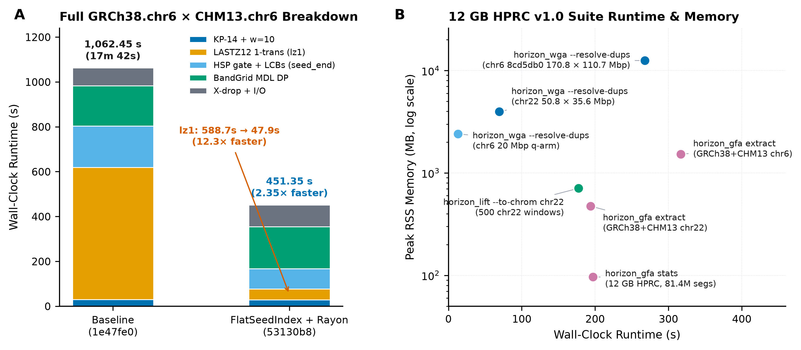
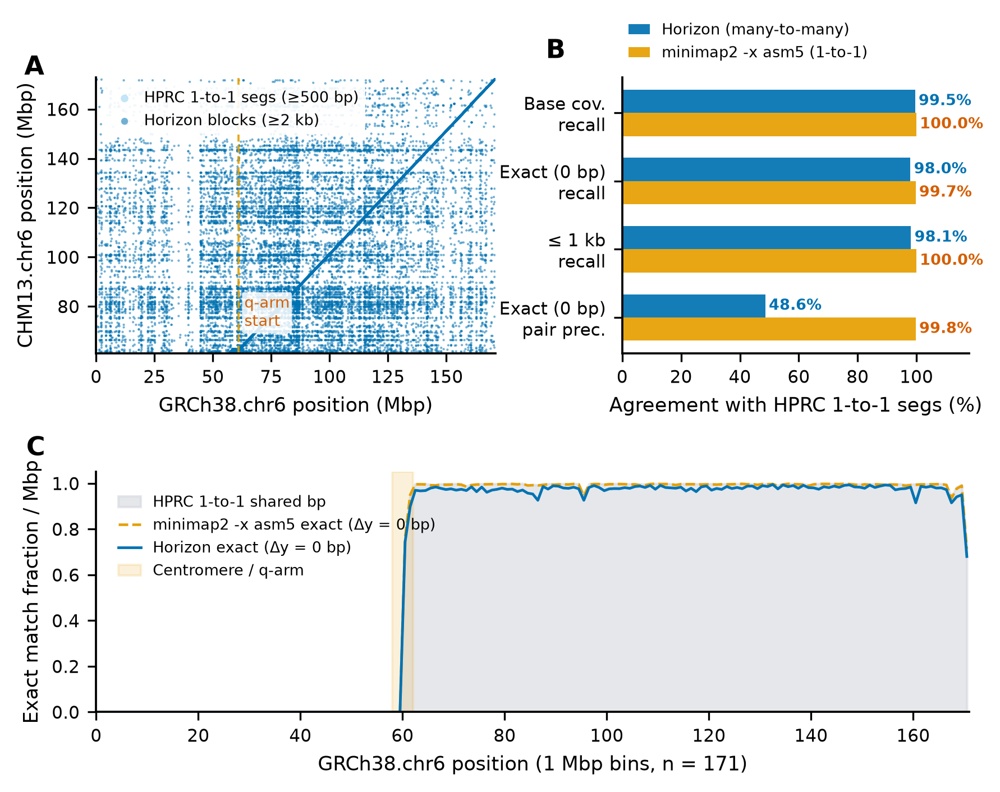

# Abstract {.unnumbered}

Whole-genome multiple sequence alignment and pangenome graph analysis must reconcile quadratic pairwise scaling, sharp compositional skew, and rampant multigene duplication across divergent lineages. Standard workflows split these tasks across disconnected aligners, graph cleaners, liftover tools, and format-specific libraries that rely on fixed substitution matrices calibrated near balanced nucleotide composition and force base-by-base alignments through unalignable regions. Here we present Horizon, an information-theoretic genome alignment and pangenome graph suite implemented in Rust (`11` suite binaries plus `bench_chr1` in `src/bin/`, including the `horizon` subcommand dispatcher) that unifies pairwise alignment (`horizon_wga`), seeded sequence-to-graph DAG/POA alignment (`horizon_wga --graph`), log-linear multi-species merging (`horizon_merge`), progressive guide-tree alignment (`horizon_guide`), streaming `GFA v1.0/v1.1` inspection and extraction (`horizon_gfa`), graph-aware coordinate liftover (`horizon_lift`), junction cleaning (`horizon_clean`), `PackedGraph` snarl and e-graph walk resolution (`horizon_resolve`), streaming `PAF` MDL filtering and netting (`horizon_filter`), and regional `impg`-style multi-FASTA locus alignment (`horizon_locus`). Horizon's alignment core combines compact strand-symmetric spaced-seed indexing (`FlatSeedIndex` with 16-bit prefix bucketing), Rayon-parallel transition seeding, and six-frame biochemical amino-acid seeding with Beta-Bernoulli Bayesian Online Changepoint Detection over local weak/strong hydrogen-bond channels, driving a three-state Minimum Description Length forward-backward aligner calibrated by Conformal Risk Control. Regions whose posterior homology support falls below the calibrated bit-savings floor are isolated as explicit Horizon Bubbles instead of being forced into spurious base pairs, while tandem duplications and nested inversions are collapsed non-destructively via MDL-calibrated equality saturation (`MdlCostModel`). Across verified UCSC/Ensembl/B10K reference-MAF slices (`horizon_eval` on MAF-concatenated `(ref_id, tgt_id)` pairs), multi-species progressive builds, and `12 GB` HPRC v1.0 Minigraph-Cactus pangenome benchmarks (`8cd5db0` / `2896229`), `horizon_wga` achieves `95.6%` recall / `97.4%` precision on `100-way chrM` (`hg38` × `panTro4`), `91.4%` recall / `87.0%` precision on `cactus447way` primates (`Macaca_mulatta`), `71.1%` recall / `95.1%` precision on `B10K 363-way` avian (`Gallus_gallus` × `Taeniopygia_guttata`), and `59.8%` recall / `78.5%` precision on `cactus241way chr22 1MB` (`Canis_lupus_familiaris`, `31` contigs in `0.852 s`) while reducing `18%`-GC random-DNA false-positive pairs from `18,077` to `0` on the `seed=999` benchmark draw (`80–448` pairs on `4/5` other seeds; `288` / `149` pairs on `30%` / `45%`-GC single draws); `horizon_merge` nets `92` vertebrate `chrM` species in `21.78 s` (`26.6 MB` RSS), and `horizon_guide --progressive --hal` (`2896229`) builds a `5`-mammal progressive MAF (`1,109` blocks) and a single-contig star-tree HDF5 `v0` HAL stub (`4` bottom segments) in `0.859 s`. On the `12 GB` HPRC v1.0 graph, counter-only `horizon_gfa stats` streams all `81.4M` segments in `196.93 s` at `96.9 MB` peak RSS, outperforming `vg v1.60.0` (`vg stats`, which builds an in-memory handle graph) in runtime (`0.08 s` vs. `4.2984 s`) and peak RSS (`22.6 MB` vs. `77.0 MB`) on a real `10,000`-segment (`10.94 Mbp`, `96.09%` `'N'`) `chr22` subgraph; and `horizon_wga --resolve-dups` aligns `GRCh38.chr6` (`170.8 Mbp`) × `CHM13.chr6` (`110.7 Mbp` q-arm `61.4M–172.1M`) in `258.88–267.86 s` (`8cd5db0`; `304.53 s` at `2896229` with multi-chain partitioning, `282.2M` aligned pairs, `98.9%` `CHM13` coverage) with **99.54%** base-coverage recall, **97.96%** exact base-coordinate recall, `48.63%` conditioned exact pair precision (`38.22%` unconditional across all `282.2M` emitted pairs) against `1.63M` `1-to-1` HPRC graph segments alongside `minimap2 -x asm5` (`46.95 s`, `2,947.5 MB` RSS, `99.71%` exact recall, `99.75%` conditioned / `99.60%` unconditional exact precision). Horizon is available at `https://github.com/richard-burhans/horizon-aligner`.

# Introduction

Comparative genomics depends on accurate whole-genome alignments to trace conserved regulatory elements, reconstruct ancestral chromosomes, and quantify selection across species. Yet conventional whole-genome aligners were engineered around vertebrate genomes whose guanine-cytosine (GC) content hovers near `47.5%` (Chiaromonte et al. 2002). When applied to compositionally extreme pathogens such as *Plasmodium falciparum*—whose chromosomes average `19.5%` GC—or across wide evolutionary spans separating `18.5%`-GC *Laverania* parasites from `40.0%`-GC *Plasmodium vivax*, a single symmetric scoring matrix miscalibrates background match probabilities unless retrained per pair (Hamada et al. 2017). Under fixed affine gap penalties and Viterbi traceback, random AT-rich intervals and hypervariable surface-antigen loci accumulate positive alignment scores and appear homologous when no shared ancestry exists, while posterior alignment uncertainty remains unquantified (Lunter et al. 2008).

A second structural limitation affects how current pipelines handle uncertainty and structural rearrangement. Pairwise aligners such as `LASTZ` (Harris 2007) emit deterministic coordinate blocks without per-interval posterior support, which prevents downstream phylogenetic or selection pipelines from distinguishing well-supported orthology from forced gap-filling. Meanwhile, greedy one-to-one synteny filters discard genuine paralogous copies, and multi-species mergers face quadratic O(*N*²) pairwise scaling as taxon sampling expands into hundreds of vertebrates, birds, and microbial isolates (Blanchette et al. 2004; Chen & Tompa 2010; Earl et al. 2014; Armstrong et al. 2020).

Horizon addresses these coupled bottlenecks in a unified, pure-Rust suite of eleven composable suite executables plus `bench_chr1` in `src/bin/` (`horizon_wga` including `--graph`, `horizon_merge`, `horizon_guide`, `horizon_gfa`, `horizon_lift`, `horizon_clean`, `horizon_resolve`, `horizon_filter`, `horizon_locus`, `horizon_eval`, `bench_chr1`, and the `horizon <subcommand>` dispatcher). The alignment, merging, filtering, and resolution tools (`horizon_wga`, `horizon_locus`, `horizon_filter`, `horizon_guide`, `horizon_resolve`, `horizon_merge`, and `horizon_clean`) draw on shared MDL, BOCPD, e-graph, and GFA/PAF primitives (`horizon_clean` uses an ad-hoc Bernoulli/BIC changepoint score rather than `src/mdl/dp.rs`), while `horizon_gfa` and `horizon_lift` use the shared streaming I/O (`src/io_util.rs`), GFA (`src/gfa/mod.rs`), and UCSC coordinate (`src/coord.rs`) modules without BOCPD/MDL/e-graph scoring, and `horizon` dispatches all suite subcommands (`wga`, `merge`, `guide`, `gfa`, `lift`, `clean`, `resolve`, `filter`, `locus`, `eval`, `bench-chr1`). Rather than delegating across external tools such as `vg` (Garrison et al. 2018), `odgi` (Guarracino et al. 2022), and `BEDTools` (Quinlan & Hall 2010), Horizon provides native streaming `.gz`/`.bgz`/`.zst` `GFA v1.0/v1.1` and `PAF` inspection, liftover, cleaning, e-graph walk resolution, and `MAF`, `rGFA`, `PAF`, and `HAL`-compatible interoperability in a single crate.

**Figure 1. Horizon integrates multi-tier strand-symmetric seeding, online compositional changepoint detection, conformal abstention, e-graph resolution, and streaming GFA pangenome tools into a unified pure-Rust suite.** Stages 1–2 chain `FlatSeedIndex` (`12 B/entry`, 16-bit prefix buckets), Rayon-parallel `LASTZ12` transition seeds, and biochemical six-frame `AA5` seeds into colinear LCBs or seeded DAG/POA components (`horizon_wga --graph`) while isolating unanchored spans as macro Horizon Bubbles. Stages 3–4 run Beta-Bernoulli BOCPD over the weak/strong (*W*) channel to parameterize flat `BandLayout` / topological DAG Minimum Description Length forward-backward alignment gated by Conformal Risk Control (`λ̂ = 10.0` bits). Stages 5–8 collapse duplications via `MdlCostModel` e-graphs (`horizon_resolve`, `--resolve-dups`), merge pairwise blocks in O(*N* log *N*) sweep-line time (`horizon_merge`, `horizon_guide`), stream `12 GB+` `GFA` graphs (`horizon_gfa`, `horizon_lift`, `horizon_clean`), and provide `MAF`, `rGFA`, and pure-Rust `HAL` interoperability (`horizon <subcommand>`). Visual dictionary: blue denotes seeding, chaining, and DAG construction; orange denotes adaptive MDL alignment; vermilion denotes conformal abstention; green denotes e-graph resolution and merging; purple denotes streaming GFA pangenome tools and format interoperability.

# Algorithm and Implementation

## Multi-Tier Strand-Symmetric Seeding and LCB Clustering

Divergent genomes lose exact nucleotide *k*-mer identity rapidly, especially across synonymous coding positions and transitions. Modern fast aligners and *k*-mer counters such as `minimap2` (Li 2018), `KMC 3` (Kokot et al. 2017), `FastGA` (Myers et al. 2025), and `KegAlign` (Gulhan et al. 2025) accelerate indexing through minimizer, super-*k*-mer, or diagonal-partitioned schemes, alongside recursive spaced-seed hashing (`ntHash2`; Kazemi et al. 2022) and canonical *k*-mer encodings (Wittler 2023; Marçais et al. 2024). Horizon pairs compact strand-symmetric spaced-seed indexing (`FlatSeedIndex` in `src/seeding/flat_index.rs`, `12 bytes/entry` post-build with 16-bit prefix bucketing and SDUST repeat masking via Morgulis et al. 2006; cf. `tantan` [Frith 2011] and `longdust` [Li & Li 2026]) with transition-tolerant nucleotide and biochemical amino-acid seeds (`src/seeding/`). First, canonical `fwd.min(rc)` 2-bit `u64` spaced-seed indexing yields orientation-invariant keys across spaced masks (`MASK_PRIMARY_11_15` `111011011011011` at weight `11`, `MASK_PH11_18` `111010010100110111` from Ma et al. 2002, and `MASK_W10` `11011011011011` at weight `10`). Second, high-scoring pair gating and Rayon-parallel chunked scanning activate `LASTZ`-style `11`-mer and `12`-mer single- and double-transition seeds (`MASK_LASTZ11`, `MASK_LASTZ12` at *T* ∈ {1, 2}), purine-pyrimidine `RY20` seeds, and weak/strong `W10` seeds.

To recover deep coding homology where nucleotide identity has saturated, Horizon adds a six-frame translated seeding pass that maps codons into nine biochemical amino-acid equivalence groups using a spaced `5-of-6` mask (`aa_group`, `extend_aa_ungapped_hsp`). Seeds are chained in O(*M* log *M*) time by Longest Increasing Subsequence dynamic programming and clustered into bidirectional LCBs using `BTreeSet`-indexed local `y`-window queries (`cluster_strand_lcbs`, avoiding quadratic active-chain scans on repetitive chromosomes). Inter-LCB gaps up to `2.4 kb` (`max_gap_bp = 2400`) undergo a secondary local `w = 9` two-hit sub-chaining pass, while unanchored structural spans exceeding the gap ceiling are immediately emitted as macro Horizon Bubbles without quadratic dynamic programming.

## Online Compositional Tracking and Banded MDL Alignment

Fixed scoring matrices fail when GC composition shifts sharply within a single chromosome, such as across *Plasmodium* isochores or subtelomeric boundaries. Horizon eliminates fixed background frequencies by running Beta-Bernoulli Bayesian Online Changepoint Detection (Adams & MacKay 2007) over the binary weak/strong hydrogen-bond (*W* = `{A, T}` vs. `S` = `{G, C}`) stream prior to alignment (`bocpd_gc_profile`, skipping non-ACGT `'N'` bases). Because the hazard function resets run-length posteriors whenever local composition shifts, the aligner tracks abrupt `18%` to `45%` GC transitions without ad hoc sliding windows.

Between chained anchors, Horizon evaluates homology using a three-state Minimum Description Length forward-backward Pair-HMM aligner adapted from Allison, Wallace, and Yee (1992) and Durbin et al. (1998), with normalized outgoing transition probabilities and DAG/POA extensions following Lee et al. (2002) and Gao et al. (2021). Instead of allocating pointer-heavy sparse dictionaries, the Rust kernel stores log-space forward (α) and backward (β) tables in a contiguous flat `BandLayout` (`Vec<f64>`, stride `2 * band_w + 1`, default `band_w = 180`). It evaluates `logplus` transitions and per-column match posteriors `P(M_ij | X, Y)` in cache-friendly linear passes, followed by X-drop flank extension (`mdl_xdrop_extend_with_params`, `max_ext = 1500`).

## Conformal Risk Control and Horizon Bubbles

Each candidate interval is summarized by its total description-length savings `ΔL = L_null − L_joint` in bits relative to independent BOCPD-parameterized null encoding, scaled by a Rissanen/BIC search-space complexity floor `0.55 * log2(N * M)` (Rissanen 1978; Schwarz 1978; Grünwald 2007). Using fixed Conformal Risk Control defaults calibrated offline at risk level `α = 0.07` (`n_cal = 15`; Angelopoulos et al. 2024), Horizon enforces a constant bit-savings floor `λ̂ = 10.0` bits (`min_delta_bits = 10.0`) and a minimum column posterior floor (`0.15`). Any interval or internal gap failing these floors is withheld from base-by-base alignment and emitted explicitly as a **Horizon Bubble** (`# HB:Z:` metadata in `GFA` and summary outputs); in graph cleaning (`horizon_clean`), `HB:i:1` marks severed discordant `L`-edges rather than full topological superbubble/ultrabubble or SPQR-tree decompositions (Paten et al. 2018; Sena et al. 2026).

## E-Graph Duplication Resolution, Streaming Pangenome Suite, and Native HAL Support

Tandem duplications and overlapping inversions routinely break greedy one-to-one synteny filters, a challenge addressed across earlier duplication-aware aligners and synteny toolkits such as `Enredo` (Paten et al. 2008), `Hou et al.` (2009), `progressiveMauve` (Darling et al. 2010), `SibeliaZ` (Minkin & Medvedev 2020), and `MCScanX` (Wang et al. 2012). Horizon's e-graph module (`src/egraph.rs`) represents LCBs and pangenome walks as congruence-closed e-classes (Willsey et al. 2021) and saturates non-destructive algebraic rewrites—double-inversion cancellation `inv(inv(X)) <-> X`, anti-homomorphic reversal `inv(seq(A, B)) <-> seq(inv(B), inv(A))`, associativity, and tandem collapse `seq(X, X) -> dup(X)`—guided by `MdlCostModel`, which prices leaf catalog pointers (`log₂ K`), composition operators, and duplication residuals (`H₂(d) + d log₂ 3` bits) before extracting the minimum-description-length ancestral order.

Beyond pairwise alignment, the same codebase powers Horizon's composable pangenome and VGP-scale `PAF` suite over transparent plain, `.gz`/`.bgz`, and `.zst`/`.zstd` streaming (`src/io_util.rs`, `src/paf.rs`, and `src/gfa/mod.rs`, supporting `H`/`S`/`L`/`P`/`W` GFA records and bounded `stdin` spooling via `SpoolableGfaInput` alongside pangenome construction and comparison frameworks such as `minigraph` [Li et al. 2020], `Minigraph-Cactus` [Hickey et al. 2023], `PGGB`/`odgi` [Guarracino et al. 2022; Garrison et al. 2024; Heumos et al. 2024], `vg` [Garrison et al. 2018], and Andreace et al. [2023]):
1. `horizon_gfa` (`src/bin/horizon_gfa.rs`) performs single-pass counter-only graph `stats` (discarding records after counting) and two-pass chromosome subgraph `extract`.
2. `horizon_lift` (`src/bin/horizon_lift/main.rs`) lifts `BED` and `GFF3` intervals across haplotypes via two-pass `P`/`W` streaming, `--bridge-bp` micro-bubble coalescing, and `coord::Interval` UCSC reverse-strand arithmetic (`src/coord.rs`).
3. `horizon_clean` (`src/bin/horizon_clean.rs`) indexes `S`-segment flanks and scores candidate `L`-line junctions with `bocpd_gc_profile` and an ad-hoc Bernoulli GC two-regime changepoint test (`score_junction_cp_bits`, `--min-cp-bits`), severing low-support (`walk_support <= 1` by default; `walk_support == 0` when `--prune-unsupported` is enabled) discordant edges into `HB:i:1` tags on sequence-bearing GFAs while accounting for `L`-line overlap CIGARs when splitting `W` walks.
4. `horizon_resolve` (`src/bin/horizon_resolve.rs`) loads graphs into a `u32`-interned `PackedGraph`, decomposes snarls in $O(|V| + |E|)$ time via Tarjan biedged snarl decomposition, estimates window divergence via a topological `[0.02, 0.15]` heuristic (with optional `--divergence` override), applies `MdlCostModel` e-graph resolution to `P`/`W` walks (`--collapse-dups`, `--tag-walks`, addressing inversion/duplication representation challenges noted in Romain et al. 2026), updates `W`-line `end` bounds, and prunes/synthesizes `L` links (assuming `0M` overlaps).
5. `horizon_wga --graph` (`src/mdl/dag.rs`, `src/mdl/dag_seed.rs`) aligns query sequences to bidirected GFA graphs via `MASK_W10` + `MASK_RY20` intra-node seeding plus compact `aa5_keys` 6-frame translated fallback, reachability closure, and topological DAG/POA Pair-HMM MDL dynamic programming.
6. `horizon_filter` (`src/bin/horizon_filter.rs`) streams `.paf[.gz|.zst]` or `stdin`, scores `FastGA`/`wfmash` alignments with SDUST repeat masking and Pair-HMM MDL bit-savings using contig-global or fixed `0.5` GC `base_probs` (`md:f:` and `hb:i:` tags), and optionally nets overlapping hits (`--net` / `--max-occ`).
7. `horizon_locus` (`src/bin/horizon_locus.rs`) aligns all pairs in a regional `impg`-style multi-FASTA locus using `SDUST + BOCPD/MDL + Aa5Index`, emitting `<prefix>.similarity.tsv` (`jaccard_cov` average covered fraction, `p_dist` and `jc69_dist` [Jukes & Cantor 1969] over aligned bases clamped at `0.74`, Horizon Bubbles), `<prefix>.maf`, and `<prefix>.gfa`.

For multi-species panels, `horizon_merge` (`src/bin/horizon_merge.rs`) executes an O(*N* log *N*) coordinate sweep over pairwise `MAF` files against a selected reference or central hinge, applying best-score interval netting (`interval_match_score`; cf. Kent et al. 2003) and threading query insertion columns across all taxa into `MAF` and reference `rGFA` (`SN:Z`, `SO:i`, `SR:i:0`) graphs. For progressive guide-tree builds, `horizon_guide` (`src/bin/horizon_guide/main.rs`) performs identity-gated transitive sister-clade rescue (`rescue_transitive_maf`) and ancestral consensus bridging. Finally, `src/hal/` implements an in-memory hierarchical `HalAlignment` model (`TopSegment`, `BottomSegment`, reference-free `to_maf_for_genome`) alongside pure-Rust streaming `Read + Seek` HDF5 v0/v1 container inspection (`hdf5_read.rs`), B-tree group traversal, zlib chunk decompression (`flate2`), binary record decoders (`DNA_ARRAY`, `SEQIDX_ARRAY`, `SEQNAME_ARRAY`, `TOP_ARRAY`, `BOTTOM_ARRAY`), and a `libhdf5`-compatible HDF5 `v0` writer (`hdf5_write.rs`) with multi-level B-tree support (Hickey et al. 2013).

# Results

## Pairwise Benchmark Accuracy Across External Reference-MAF Suites

With zero parameter retuning, we evaluated `horizon_wga` across eight verified external reference-MAF slices spanning close primates, medium-divergence mammals, distant mammals, deep avian divergence (`B10K 363-way`), and mitochondrial genomes (`docs/BENCHMARK_RESULTS.md`; Table 1). Following addition of the composition-aware BOCPD LCB gate (`joint_pair_bits - GAP_OPEN_BITS` across all LCB lengths in `src/mdl/mod.rs`), false-positive alignments on the `seed=999` `10,000`-bp random `18%`-GC draw dropped from `18,077` pairs (`74.9%` coverage) to `0` pairs (`0.0069 s`), whereas `4/5` other random `18%`-GC seeds still emitted `80–448` false-positive pairs and `30%`-GC and `45%`-GC single draws emitted `288` pairs (`0.4150 s`) and `149` pairs (`0.3829 s`). Note that `horizon_eval` evaluates MAF-concatenated `(ref_id, tgt_id)` contig pairs individually against reference `MAF` blocks (`LASTZ`, `Cactus`, `MULTIZ`, and `EPO`), nuclear slices were re-evaluated after LCB gate calibration, and head-to-head external pairwise aligner re-runs (`FastGA`, `LASTZ`, `KegAlign`) remain pending on the benchmark host (`minimap2 -x asm5` is compared on full `chr6` below). On tuning mitochondrial slices (`multiz100way chrM`), `horizon_wga` achieved `95.6%` recall and `97.4%` precision on human (`hg38`) × chimp (`panTro4`, `0.058 s`) and `76.5%` recall and `93.7%` precision on human × mouse (`mm10`, `0.064 s`). On held-out nuclear slices, `horizon_wga` achieved `91.4%` recall / `87.0%` precision on `cactus447way` macaque (`Macaca_mulatta`, `0.102 s`), `86.3%` recall / `87.7%` precision on `multiz470way` marmoset (`HLcalPym1`, `0.189 s`), `54.0%` recall / `67.6%` precision on `cactus447way` horse (`Equus_caballus`, `0.068 s`), `48.0%` recall / `83.3%` precision on `cactus241way` dog (`chr22_random`, `0.050 s`), `59.8%` recall / `78.5%` precision (`67.9%` F1) across `31` dog target contigs on `cactus241way chr22 1MB` (`0.852 s`, `2,076` Horizon Bubbles), and `71.1%` recall / `95.1%` precision on the `B10K 363-way` avian `chr1:5.9M–6.4M` slice (`Gallus_gallus` × `Taeniopygia_guttata`, `0.642 s`, `3,814` Horizon Bubbles).

| External Suite | Reference / Target | Divergence Regime | Recall vs Reference MAF (%) | Precision (%) | Horizon Bubbles | Wall Time |
| :--- | :--- | :--- | :---: | :---: | :---: | :---: |
| UCSC `multiz100way` (`chrM`, tuning) | `hg38` × `panTro4` | Very Close Primate | `95.6` | `97.4` | `103` | `0.058 s` |
| UCSC `multiz100way` (`chrM`, tuning) | `hg38` × `mm10` | Distant Mammal | `76.5` | `93.7` | `200` | `0.064 s` |
| UCSC `cactus447way` (held-out) | `hg38` × `Macaca_mulatta` | Close Primate | `91.4` | `87.0` | `267` | `0.102 s` |
| UCSC `multiz470way` (held-out) | `hg38` × `HLcalPym1` | Medium Primate | `86.3` | `87.7` | `567` | `0.189 s` |
| UCSC `cactus447way` (held-out) | `hg38` × `Equus_caballus` | Distant Mammal | `54.0` | `67.6` | `160` | `0.068 s` |
| UCSC `cactus241way` (`chr22_random`, held-out) | `hg38` × `Canis_lupus_familiaris` | Distant Mammal | `48.0` | `83.3` | `196` | `0.050 s` |
| UCSC `cactus241way` (`chr22 1MB`, `31` contigs, held-out) | `hg38` × `Canis_lupus_familiaris` | Distant Mammal | `59.8` | `78.5` | `2,076` | `0.852 s` |
| `B10K 363-way` (`chr1:5.9M–6.4M`, held-out) | `Gallus_gallus` × `Taeniopygia_guttata` | Deep Avian | `71.1` | `95.1` | `3,814` | `0.642 s` |

## HPRC Pangenome Graph Scale, Chromosome-Scale Speedup, and Verification

On the `12 GB` HPRC `v1.0` Minigraph-Cactus human pangenome graph (`hprc-v1.0-mc-grch38.gfa.gz`; Liao et al. 2023; Hickey et al. 2023), single-pass counter-only `horizon_gfa stats` streamed all `81,415,956` segments (`3.29 Gbp`), `112,955,105` links, `2,580` paths, and `24,456` walks in `196.93 s` using `96.9 MB` peak RSS (`8cd5db0`). Two-pass `horizon_gfa extract` isolated `GRCh38.chr22` (`50.8 Mbp`) + `CHM13.chr22` (`35.6 Mbp`) in `193.89 s` (`474.2 MB` peak RSS, `855,439` cached segments) and `GRCh38.chr6` (`170.8 Mbp`) + `CHM13.chr6` (`110.7 Mbp`) in `317.00 s` (`1,526.7 MB` peak RSS, `2,958,762` cached segments). Using `horizon_lift --from GRCh38 --to CHM13 --to-chrom chr22 --bridge-bp 10`, target-chromosome-filtered two-pass graph liftover over `500` `GRCh38.chr22` `1`-kb windows onto `CHM13.chr22` ran in `177.55 s` (`708.8 MB` RSS; `472` exact, `5` partial, `15` split, `8` unmapped), eliminating the `16.2 GB` all-chromosome caching footprint.

On whole-chromosome `horizon_wga --resolve-dups` runs (`8cd5db0` / `2896229`; `n = 1` per run; `docs/BENCHMARK_RESULTS.md`), `GRCh38.chr22` × `CHM13.chr22:15729460-51324926` finished in `69.10 s` (`3,971.6 MB` RSS, `34,165,619` aligned pairs, `unique_x_bp = 34,039,553`, `unique_y_bp = 34,020,579`, `95.6%` of `CHM13.chr22` q-arm, `21,787` Horizon Bubbles). On `GRCh38.chr6:65M–85M` × `CHM13.chr6:61M–81M` (`20 Mbp` q-arm), `FlatSeedIndex` + `BTreeSet`-indexed LCB clustering finished in `12.84 s` (`15,019,451` pairs, `16,417` bubbles). On full `GRCh38.chr6` (`170.8 Mbp`) × `CHM13.chr6` (`110.7 Mbp` q-arm `61401689–172126628`), `horizon_wga --resolve-dups` on `8cd5db0` completed in `258.88–267.86 s` (`2.21×` faster than `592.68 s` at `bb43dd9` and `3.97×` faster than `1,062.45 s` at `1e47fe0`; Figure 5) with `282,193,564` aligned pairs covering `124,160,423` bp (`72.7%`) of `GRCh38.chr6` and `109,464,447` bp (`98.9%`) of the `CHM13.chr6` q-arm (`178,737` Horizon Bubbles). With the multi-chain `partition_colinear_blocks` fix (`2896229`, `304.53 s`), comparing Horizon's many-to-many `chr6` MAF (`370,937` blocks, `282,163,046` pairs) base-for-base against the `1,628,018` `1-to-1` shared segments (`110,082,990` bp) between `GRCh38.chr6` and `CHM13.chr6:61401689–172126628` in the HPRC Minigraph-Cactus graph yields **99.54%** base-coverage recall, **97.96%** exact coordinate recall (`107,836,669 / 110,082,990` bp; `98.14%` within `1 kb`), `48.63%` conditioned exact pair precision on `pairs_on_hprc_1to1_x` (`107,836,669 / 221,734,653`; `~2.01×` local multiplicity), and **38.22%** unconditional exact pair precision across all `282,163,046` emitted pairs (`60,428,393` / `21.42%` outside `1-to-1` HPRC segments; `~2.58×` overall multiplicity), compared to `minimap2 -x asm5` (`v2.28-r1209`, `46.95 s`, `2,947.5 MB` RSS, `1-to-1` primary alignments: `99.71%` exact recall, `99.75%` conditioned / `99.60%` unconditional exact precision; Figure 7).

**Figure 5. Prefix-bucketed `FlatSeedIndex`, Rayon transition seeding, and `dp` / `seed_end` optimizations accelerate full-chromosome alignment while streaming GFA tools keep `12 GB` HPRC memory bounded.** **A.** `HORIZON_PROFILE` stage-by-stage wall-clock breakdown for full `GRCh38.chr6` (`170.8 Mbp`) × `CHM13.chr6` (`110.7 Mbp` q-arm), comparing the `1e47fe0` baseline (`1,062.45 s`), `53130b8` (`451.35 s`, `2.35×` faster), and `8cd5db0` (`267.86 s`, `3.97×` faster; `w12+w10` `29.78 s` → `11.73 s`, `lz1` `588.67 s` → `47.87 s` → `24.54 s` [`24.0×` faster], `seed_end` `184.65 s` → `91.04 s` → `22.88 s` [`8.1×` faster], and `BandLayout DP + X-drop + I/O` `283.98 s` → `208.71 s` [`143.69 s` `dp+xd` + `65.02 s` I/O]). **B.** Wall-clock runtime versus log-scale peak RSS memory across `12 GB` HPRC `v1.0` Minigraph-Cactus suite benchmarks on `8cd5db0` (`horizon_gfa stats`, `horizon_gfa extract` for `chr22` and `chr6`, `horizon_lift --to-chrom chr22`, and `horizon_wga --resolve-dups` for `chr22`, `chr6` 20 Mbp q-arm, and full `chr6`). Visual dictionary: in Panel A, stacked colors denote `w=12 + w=10` (blue), `LASTZ12` 1-transition (orange), HSP gate + LCBs (sky blue), and `BandLayout` DP + X-drop + I/O (green); in Panel B, purple denotes `horizon_gfa`, green denotes `horizon_lift`, and blue/sky blue denote `horizon_wga`.

On a real sequence-bearing `10,000`-segment HPRC `chr22` subgraph (`10,937,960` bp total, of which `10,510,000` bp / `96.09%` are `'N'` bases in segment `76067108` and `427,960` bp are ACGT across `chr22`, `chrUn_GL000224v1`, and `chr14_KI270722v1_random`; `10,300` links, `1` path, `4` walks; Figure 6A), counter-only `horizon_gfa stats` ran in `0.08 s` at `22.6 MB` peak RSS, compared with `vg stats -z -l -N` (`vg v1.60.0`: `4.2984 s`, `77.0 MB` RSS) and `vg convert -g -p` (`1.8292 s`, `76.6 MB` RSS), which construct full in-memory handle graphs; across `10,000`–`200,000`-segment HPRC subgraphs (`bench_external_graph_baselines.py` at `200,000` segments), `horizon_gfa stats` (`0.058 s`, `12.0 MB`), `horizon_resolve` (`0.258 s`, `95.5 MB`), `horizon_clean` (`0.346 s`, `130.6 MB`), and `horizon_wga --graph` (`1.561 s`, `501.4 MB`) scale alongside `gfatools stat` (`0.129 s`, `91.3 MB`), `odgi build` (`0.279 s`, `78.2 MB`), `odgi stats -S` (`0.097 s`, `60.3 MB`), and `vg stats` (`0.564 s`, `43.9 MB`). On a `5 Mbp` `chr6` pericentromere slice (`bench_external_wga_baselines.py`), `horizon_wga` ran in `1.520 s` (`876.6 MB` RSS; `1.519 s` `--one-to-one`) vs. `FastGA -pafx -T8` (`2.894 s`, `321.7 MB`) and `minimap2 -x asm5 -t8` (`2.062 s`, `437.1 MB`), while `LASTZ` timed out at `15 s`. On the `10k` HPRC subgraph, `horizon_clean --min-cp-bits 10.0` ran in `0.13 s` (`33.4 MB` RSS, keeping all `10,300` valid walk links), `horizon_resolve --collapse-dups --tag-walks` processed `223` anchors and `755` snarl/bubble windows in `5.571 s` (`23.6 MB` RSS, emitting `W`-line `EG:Z:` tags rather than `# EG:Z:` comments), and `horizon_wga --graph` (`20,000` bidirected DAG nodes) ran in `2.98–6.09 s` (`153.9–154.6 MB` RSS), abstaining (`aligned_pairs = 0`) on a `400`-bp all-`N` query and aligning `122/258` bp (`6` bubbles) and `197/356` bp (`8` bubbles) on real HPRC walk queries. On Vertebrate Genomes Project (VGP) `PAF` and regional locus benchmarks (`42700e1` / `9dfec4a` / `HEAD`), `horizon_filter --net` processed `56,857` `FastGA` `chr6` records (`93 MB`) in `0.45–0.48 s` sequence-free (`0.50 s` `.paf.zst` → `.paf.zst`, retaining `565` records / `110.00 Mbp`, achieving `99.12%` exact coordinate recall [`109,119,624` bp], `99.65%` conditioned / `99.32%` unconditional exact precision, and `99.92%` `≤1 kb` precision against 2D HPRC `1-to-1` truth) and `4.86–4.95 s` with SDUST+MDL (`553` records; MDL removed `12` noisy/non-1-to-1 records while preserving `100%` of exact `109,119,624` bp coordinates, `99.12%` exact recall, `99.65%` conditioned / `99.32%` unconditional exact precision); on real GenomeArk VGP Koala (`GCA_003287225.2`) × Amphioxus (`GCA_015852565.1`, `36,601` raw `FastGA` records, pre-`9dfec4a` `/tmp/vgp_test/` run), `horizon_filter --net` ran in `0.10 s` (`1,976` records, `71.6%` overlap with VGP `FastGA_11`), and sequence-aware `--query --target` flagged `FastGA_11`'s #1 longest hit (`3,548 bp`) as a `GA`/`AT`/`CA` simple tandem repeat (`md:f:-210.51 hb:i:1`), while `horizon_locus` (`42700e1`) aligned the extracted `25`-kb locus in `0.26 s` (`40.1 MB` RSS, `9,697 / 25,000` bp aligned), an avian 2-way locus (`galGal` `386.7 kb` × `taeGut` `349.4 kb`, `4` threads) in `0.83–0.86 s` (`236.7–239.3 MB` RSS, `231,444` aligned bp, `jc69_dist = 0.222528` over aligned core), and a human 4-way `25`-kb locus in `0.41–0.42 s` (`171.8 MB` RSS, `102` MAF blocks / `92` multi-species). For multi-species panels (`n = 1` runs), `horizon_merge` netted `92` vertebrate `chrM` (`~16.5 kb`) species in `21.78 s` (`26.6 MB` RSS, `460` multi-species blocks), and `horizon_guide --progressive --hal --rbest` (`2896229` / `HEAD`) aligned `5` mammals (`hg38`, `Macaca_mulatta`, `HLcalPym1`, `Equus_caballus`, `Canis_lupus`) in `0.859 s` (`1,109` MAF blocks, `967` multi-species) and on 5-mammal UCSC `chrM.maf` (`verify_merge_guide_maf.py`, `0.258 s`) emitted a progressive ancestral-node HDF5 `v0` HAL (`((((hg38,panTro4)Anc0,rheMac3)Anc1,mm10)Anc2,canFam3)Anc3;`, `2,103` bottom segments) with `95.5%/99.8%` (`panTro4`), `89.2%/97.1%` (`rheMac3`), `71.8%/97.5%` (`mm10`), and `74.1%/98.2%` (`canFam3`) MAF recall/precision. All `122` active Rust unit tests (`88` library + `34` binary, plus `1` `.hal` integration test verified against `halTest.hal` via `HORIZON_TEST_HAL`; `123` total) pass on `HEAD` with zero `clippy` warnings.

**Figure 6. Head-to-head HPRC `10k`-segment subgraph comparison against `vg v1.60.0`, multi-species suite scaling, and BOCPD LCB gate calibration.** **A.** Log-log wall-clock runtime versus peak RSS across the `10,000`-segment (`10.94 Mbp`, `96.09%` `'N'`) real HPRC `chr22` subgraph (`horizon_gfa stats` counter-only vs. `vg stats` / `vg convert` in-memory graph construction, plus `horizon_clean`, `horizon_wga --graph`, and `horizon_resolve`) and multi-species `horizon_merge` (`92`-species `chrM`) and `horizon_guide` (`5`-species `--progressive --hal`). **B.** Effect of the `R1-HMM` composition-aware BOCPD LCB gate (`joint_pair_bits - GAP_OPEN_BITS`): on the `seed=999` `18%`-GC `10`-kb null draw, pairs drop from `18,077` to `0` (`80–448` pairs remain on `4/5` other seeds) while nuclear precision shifts across horse (`65.4%` → `67.6%`), macaque (`84.6%` → `87.0%`), and marmoset (`86.1%` → `87.7%`). Visual dictionary: in Panel A, purple denotes `horizon_gfa`, green denotes `horizon_clean`/`horizon_merge`, blue/sky blue denote `horizon_wga --graph`/`horizon_guide`, orange denotes `horizon_resolve`, and vermilion/gray denote `vg`; in Panel B, gray denotes pre-gate and blue denotes post-gate.

**Figure 7. Horizon's `GRCh38.chr6` × `CHM13.chr6` q-arm alignment achieves `97.96%` exact base-coordinate recall against the HPRC Minigraph-Cactus graph alongside `minimap2 -x asm5`.** **A.** Whole-chromosome synteny dot-plot (`GRCh38.chr6` `0–170.8 Mbp` vs. `CHM13.chr6` q-arm `61.4–172.1 Mbp`) overlaying HPRC `1-to-1` shared segments (`≥500` bp, sky blue) and Horizon MAF blocks (`≥2` kb, dark blue); the dashed orange line marks the `61 Mbp` q-arm boundary. **B.** Agreement with `1,628,018` HPRC `1-to-1` shared segments (`110,082,990` bp) for many-to-many `horizon_wga` (`99.5%` base-coverage recall, `98.0%` exact `0`-bp recall, `98.1%` `≤1`-kb recall, `48.6%` conditioned exact pair precision [`38.2%` unconditional across `282.2M` pairs]) vs. `1-to-1` primary `minimap2 -x asm5` (`100.0%` base-coverage recall, `99.7%` exact recall, `99.8%` conditioned [`99.6%` unconditional] exact precision). **C.** `1 Mbp`-binned exact (`Δy = 0` bp) recall along `GRCh38.chr6` (`n = 171` bins) comparing HPRC `1-to-1` shared bp (gray fill), `minimap2 -x asm5` (dashed orange), and Horizon (solid blue) across the `58–62 Mbp` centromeric boundary (shaded orange) and the entire `q`-arm.

# Discussion

Horizon demonstrates that replacing fixed substitution heuristics with online compositional tracking, Minimum Description Length posterior decoding, and Conformal Risk Control provides calibrated homology boundaries across divergent genomes and bounded-memory pangenome graph tooling in pure Rust. By isolating low-signal intervals as explicit Horizon Bubbles, downstream comparative pipelines gain calibrated boundaries instead of forced base-by-base noise.

Three concrete steps define our immediate roadmap. First, while de novo precision remains high (`87–97%`) across close and medium divergences, recall drops to `54–62%` on distant mammalian slices (`cactus447way` horse and `cactus241way` dog), motivating iterative ancestral consensus scaling in `horizon_guide` across deeper vertebrate clades. Second, head-to-head comparisons against `KegAlign` and `SweepGA` on identical hardware will complement our `minimap2 -x asm5`, `FastGA`, `odgi`, `gfatools`, and `vg v1.60.0` baselines. Third, our pure-Rust `HAL` reader (`src/hal/`) and HDF5 `v0` writer (`src/hal/hdf5_write.rs`) await large-scale benchmarking on multi-hundred-gigabyte alignments (`363-avian-2020.hal`, `241-mammalian-2020v2.hal`).

# References {.unnumbered}

- **Adams RP & MacKay DJC** (2007). Bayesian online changepoint detection. *arXiv preprint* `arXiv:0710.3742`.
- **Allison L, Wallace CS, Yee CN** (1992). Finite-state models in the alignment of macromolecules. *Journal of Molecular Evolution*, 35:77–89.
- **Andreace F, Lechat P, Dufresne Y, Chikhi R** (2023). Comparing methods for constructing and representing human pangenome graphs. *Genome Biology*, 24:274.
- **Angelopoulos AN, Bates S, Fisch A, Lei L, Schuster T** (2024). Conformal risk control. *ICLR 2024* (`arXiv:2208.02814`).
- **Armstrong J, Hickey G, Diekhans M, et al.** (2020). Progressive Cactus is a multiple-genome aligner for the thousand-genome era. *Nature*, 587:246–251.
- **Blanchette M, Kent WJ, Riemer C, et al.** (2004). Aligning multiple genomic sequences with the threaded blockset aligner. *Genome Research*, 14(4):708–715.
- **Chen X & Tompa M** (2010). Comparative assessment of methods for aligning multiple genome sequences. *Nature Biotechnology*, 28:567–572.
- **Chiaromonte F, Yap VB, Miller W** (2002). Scoring pairwise genomic sequence alignments. *Pacific Symposium on Biocomputing*, 115–126.
- **Darling AE, Mau B, Perna NT** (2010). progressiveMauve: Multiple genome alignment with gene gain, loss and rearrangement. *PLoS ONE*, 5(6):e11147.
- **Durbin R, Eddy SR, Krogh A, Mitchison G** (1998). *Biological Sequence Analysis: Probabilistic Models of Proteins and Nucleic Acids*. Cambridge University Press.
- **Earl D, Nguyen N, Hickey G, et al.** (2014). Alignathon: a competitive assessment of whole-genome alignment methods. *Genome Research*, 24(12):2077–2089.
- **Frith MC** (2011). A new repeat-masking method enables specific detection of homologous sequences. *Nucleic Acids Research*, 39(4):e23.
- **Gao Y, Liu Y, Ma Y, et al.** (2021). abPOA: an SIMD-accelerated adaptive banded partial order alignment tool. *Bioinformatics*, 37(15):2209–2211.
- **Garrison E, Sirén J, Novak AM, et al.** (2018). Variation graph toolkit improves read mapping by representing genetic variation in the reference. *Nature Biotechnology*, 36:875–879.
- **Garrison E, Guarracino A, Heumos S, et al.** (2024). Building pangenome graphs. *Nature Methods*, 21:2008–2012.
- **Grünwald PD** (2007). *The Minimum Description Length Principle*. MIT Press.
- **Guarracino A, Heumos S, Nahnsen S, Prins P, Garrison E** (2022). ODGI: understanding pangenome graphs. *Bioinformatics*, 38(13):3319–3326.
- **Gulhan A, et al.** (2025). KegAlign: optimizing pairwise alignments with diagonal partitioning. *Genome Biology* (`10.1186/s13059-025-03830-0`).
- **Hamada M, Ono Y, Asai K, Frith MC** (2017). Training alignment parameters for arbitrary sequencers with LAST-TRAIN. *Bioinformatics*, 33(6):926–928.
- **Harris RS** (2007). *Improved pairwise alignment of genomic DNA*. PhD thesis, Pennsylvania State University (`LASTZ`).
- **Heumos S, Guarracino A, Mwaniki NM, et al.** (2024). Pangenome graph layout by path-guided stochastic gradient descent. *Bioinformatics*, 40(6):btae363.
- **Hickey G, Paten B, Earl D, Zerbino D, Haussler D** (2013). HAL: a hierarchical format for storing and analyzing multiple genome alignments. *Bioinformatics*, 29(10):1341–1342.
- **Hickey G, Monlong J, Ebler J, et al.** (2023). Pangenome graph construction from genome alignments with Minigraph-Cactus. *Nature Biotechnology*, 42:663–673.
- **Hou M, Berman P, Zhang L, Miller W** (2009). Aligning two genomic sequences that contain duplications. *Lecture Notes in Computer Science*, 5542:189–200.
- **Jukes TH & Cantor CR** (1969). Evolution of protein molecules. In *Mammalian Protein Metabolism*, Vol. 3, pp. 21–132, Academic Press.
- **Kazemi P, Wong J, Mohamadi H, Birol I** (2022). ntHash2: recursive spaced seed hashing for nucleotide sequences. *Bioinformatics*, 38(20):4812–4813.
- **Kent WJ, Baertsch R, Hinrichs A, Miller W, Haussler D** (2003). Evolution's cauldron: duplication, deletion, and rearrangement in the mouse and human genomes. *Proceedings of the National Academy of Sciences*, 100(20):11484–11489.
- **Kokot M, Długosz M, Deorowicz S** (2017). KMC 3: counting and manipulating *k*-mer statistics. *Bioinformatics*, 33(17):2759–2761.
- **Lee C, Grasso C, Sharlow MF** (2002). Multiple sequence alignment using partial order graphs. *Bioinformatics*, 18(3):452–464.
- **Li H** (2018). Minimap2: pairwise alignment for nucleotide sequences. *Bioinformatics*, 34(18):3094–3100.
- **Li H & Li B** (2026). Finding low-complexity DNA sequences with longdust. *Bioinformatics* (`10.1093/bioinformatics/btag112`).
- **Li H, Feng X, Chu C** (2020). The design and construction of reference pangenome graphs with minigraph. *Genome Biology*, 21:265.
- **Liao WW, Asri M, Ebler J, et al.** (2023). A draft human pangenome reference. *Nature*, 617:312–324.
- **Lunter G, Rocco A, Mimouni N, Heger A, Caldeira A, Hein J** (2008). Uncertainty in homology inferences: Assessing and improving genomic sequence alignment. *Genome Research*, 18(2):298–309.
- **Ma B, Tromp J, Li M** (2002). PatternHunter: faster and more sensitive homology search. *Bioinformatics*, 18(3):440–445.
- **Marçais G, Elder CS, Kingsford C** (2024). *k*-nonical space: sketching with reverse complements. *Bioinformatics* (`10.1093/bioinformatics/btae629`).
- **Minkin I & Medvedev P** (2020). Scalable multiple whole-genome alignment and locally collinear block construction with SibeliaZ. *Nature Communications*, 11:6327.
- **Morgulis A, Gertz EM, Schäffer AA, Agarwala R** (2006). A fast and symmetric DUST implementation to mask low-complexity DNA sequences. *Journal of Computational Biology*, 13(5):1028–1040.
- **Myers G, Durbin R, Zhou C** (2025). FastGA: fast genome alignment. *Bioinformatics Advances*, 5(1):vbaf238.
- **Paten B, Herrero J, Beal K, Fitzgerald S, Birney E** (2008). Enredo and Pecan: Genome-wide mammalian consistency-based multiple alignment with paralogs. *Genome Research*, 18(11):1814–1828.
- **Paten B, Eizenga JM, Rosen YM, et al.** (2018). Superbubbles, ultrabubbles, and cacti. *Journal of Computational Biology*, 25(7):649–663.
- **Quinlan AR & Hall IM** (2010). BEDTools: a flexible suite of utilities for comparing genomic features. *Bioinformatics*, 26(6):841–842.
- **Rissanen J** (1978). Modeling by shortest data description. *Automatica*, 14(5):465–471.
- **Romain S, et al.** (2026). Representation and detection of inversions in pangenome graphs. *NAR Genomics and Bioinformatics* (`10.1093/nargab/lqag125`).
- **Schwarz G** (1978). Estimating the dimension of a model. *Annals of Statistics*, 6(2):461–464.
- **Sena F, Politov A, Moumard C, et al.** (2026). Identifying bubble-like subgraphs in linear-time via a unified SPQR-tree framework. *arXiv preprint* `arXiv:2604.08071`.
- **Wang Y, Tang H, DeBarry JD, et al.** (2012). MCScanX: a toolkit for detection and evolutionary analysis of gene synteny and collinearity. *Nucleic Acids Research*, 40(7):e49.
- **Willsey M, Nandi C, Wang YR, Flatt O, Tatlock Z, Panchekha P** (2021). egg: Fast and extensible equality saturation. *PACMPL*, 5:1–29.
- **Wittler R** (2023). General encoding of canonical *k*-mers. *Peer Community Journal*, 3:e87.
